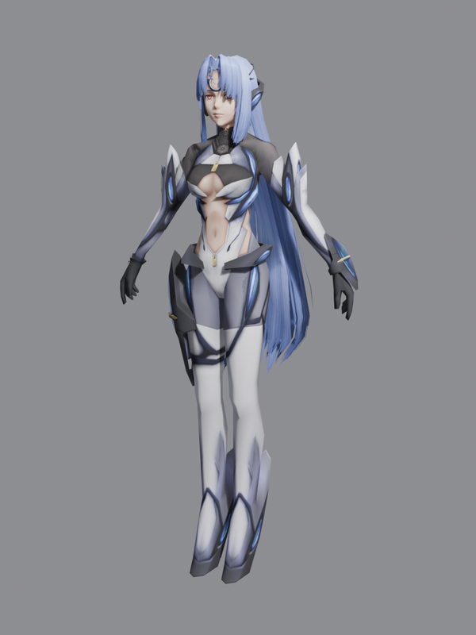
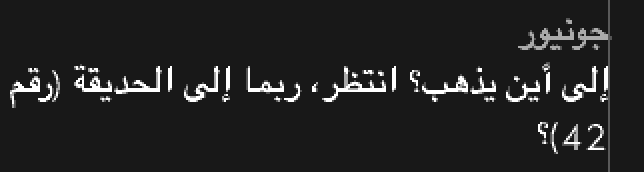
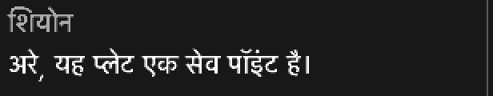
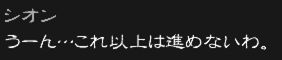
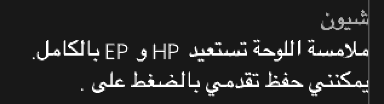
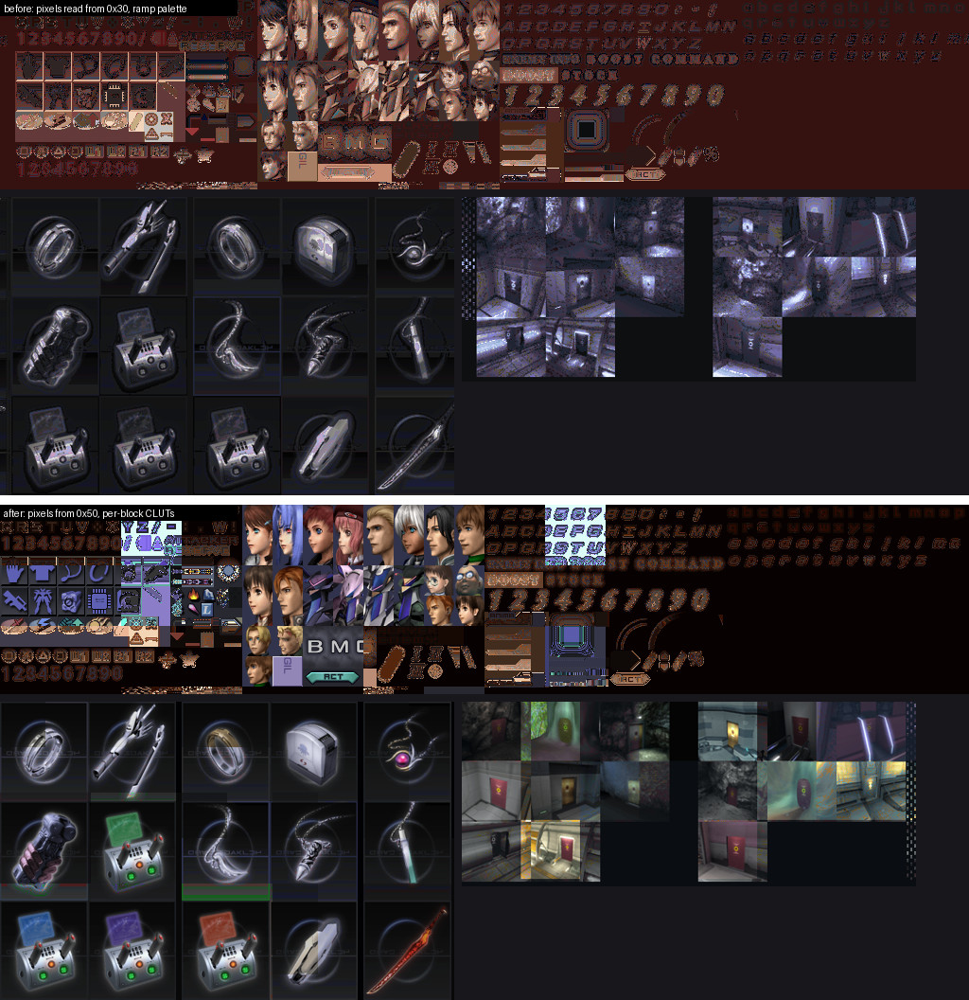
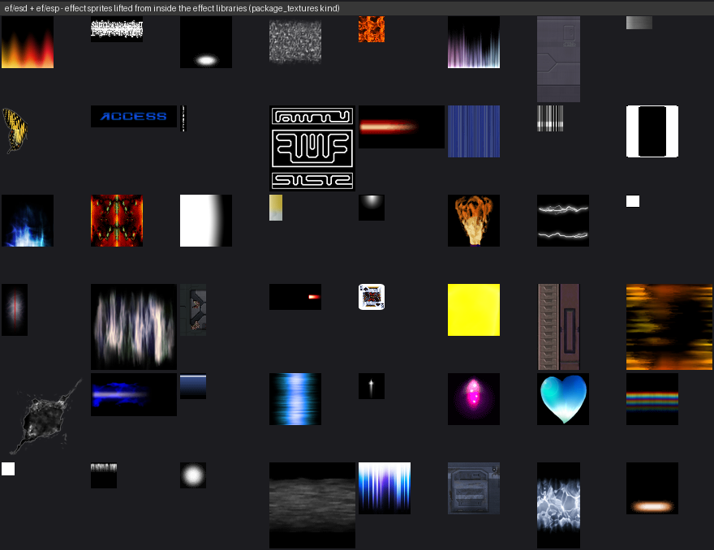
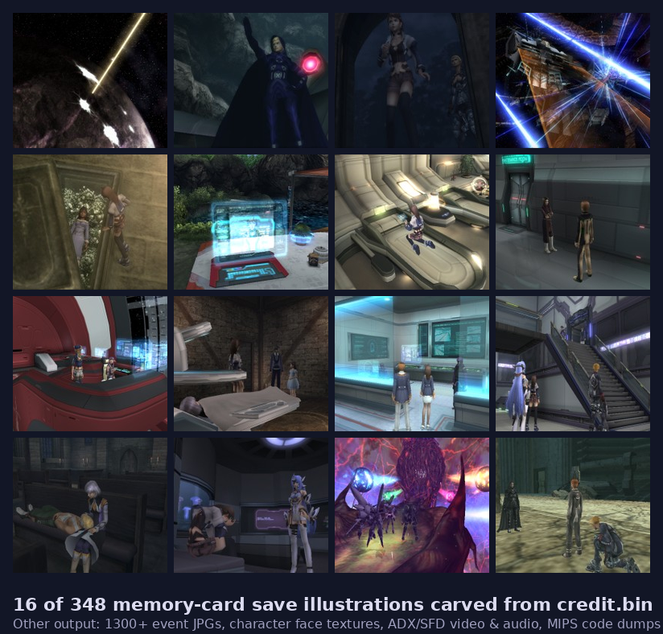

# Xenosaga III Python Extractor

By Jessi Ray Godsibb. Originally bootstrapped with ChatGPT; rebuilt around the
corrected disc model.

Unpack, browse and mod **Xenosaga Episode III — Also sprach Zarathustra** (PS2)
with nothing but Python. Point it at your own disc image and you get every
file on the disc in a form your computer can open: **models as glTF and
ready-made `.blend` files for Blender**, textures and pictures as PNG, voices
and music as WAV, cutscenes as MP4, and game text as UTF-8. It reads the USA
discs (SLUS_213.89 / SLUS_214.17), **the Japanese discs (SLPS_256.40 /
256.41)** and the May 2006 press prototype. Then it writes your changes —
edited text, new letters, a whole new script — into copies of the discs.

The kit ships no game data. **Use your own legally obtained discs only.**

> **Beta — feedback wanted.** Please open issues at
> <https://github.com/LinuxJessi/Xenosaga3PythonExtractor/issues>.
> Reading is tested on all five images. **The write side (text import, new
> scripts, fonts, pictures, grown files) is tested on disc copies and in
> previews only: no disc built by this kit has been booted in PCSX2 yet.**
> Treat your first boot as the real test, and tell us what you see.



*KOS-MOS as `python cli.py blend` writes her: textures packed, Material
Preview on, the armature drawn as sticks. Rendered by Blender from the
saved file.*

| | |
|---|---|
|  |  |
|  |  |

*Arabic, Hindi and Japanese lines read back from patched copies of USA Disc 1
and drawn with `lang preview` through that copy's own executable rules and
rebuilt font. These are kit previews, not emulator captures.*

## Feature tour

### The whole party, straight into Blender


*Shion, MOMO, Jr., chaos, Ziggy and Jin: one `blend --iso D1.iso --path
'mdl\chr\pc\C3<name>00.chr' --render <name>.png` each, Workbench render,
nothing touched up. Every `.chr`, `.wpn` and `.map` on all five discs
converts the same way (1,609 models per disc).*

### Translate it — into any script

* **Export** every line the game shows (scenes, menus, encyclopedia, battle
  messages, subtitles) as one UTF-8 tree, **edit**, and **import** it back
  into copies of both discs. An unchanged export rebuilds byte-identical.
* **New writing systems:** Arabic and Hebrew (right-to-left, bidi checked
  against ICU), Devanagari and anything else HarfBuzz shapes, drawn from your
  TrueType font into the game's free font cells.
* **Japanese on the English game:** kana and kanji donated from the Japanese
  disc's font, plus an executable unlock.
* **Text inside pictures:** title cards, HUD word sheets, logos and the
  battle HUD's bitmap letters export to PNG and go back in.
* Guides: [TRANSLATING.md](docs/TRANSLATING.md) ·
  [SCRIPTS.md](docs/SCRIPTS.md) · [FONT.md](docs/FONT.md)

### Japan, USA and the 2006 prototype side by side

The kit tells the builds apart by the boot executable's hash, reads each with
its own codec and font rules, lists the 140 scenes that exist only in the
Japanese release, and `align-export` lines the Japanese script up against the
English one (TSV, JSON or a dual-language SRT).

### Textures in their real colours



*Top: what every earlier version produced. Bottom: pixels read from the
right offset and each icon, thumbnail and portrait given its own palette.*

| | |
|---|---|
|  |  |
| *LZSS-packed field maps decoded* | *Effect-file textures* |

### Write it back safely

`patch` only writes **copies**: in place when a file fits, appended with
`--grow` when it doesn't, Disc 1 and Disc 2 kept in step, every file read back
afterwards, and mixed USA/Japan pairs refused.

## What you get

| | |
|---|---|
| Models | all 1,609 models per disc (`.chr` / `.wpn` / `.map` packages and the standalone `.pxy`) as `.glb`: mesh, UVs, textures inside the file, skin weights and a skeleton for the skinned ones (1,014 on each Japanese disc). `blend` turns one into a `.blend` that opens textured, framed and without "bone balls". [docs/BLENDER.md](docs/BLENDER.md), [docs/MODELS.md](docs/MODELS.md) |
| Japanese discs | detected by the boot executable's hash; 46 executable addresses checked against the code at run time; every Japanese text container reads and rebuilds byte-identically; 140 scenes that exist only in Japanese are listed; `align-export` puts the Japanese and English script side by side (TSV, JSON, dual SRT) |
| Text | the scene scripts (`.sb`), menu tables (`.txd`), menu databases (`mnu\xx\*.bin`), `Message.Dat`, `batdat.bin`, movie/event subtitles and `.mes` files as one UTF-8 tree. `text-import` checks an edited tree (codec, font ink, sizes) and writes it into copies of Disc 1 + Disc 2. [docs/TRANSLATING.md](docs/TRANSLATING.md) |
| New scripts | `lang scan / encode / import / preview` draws Arabic, Hebrew, Devanagari or any HarfBuzz-shaped script from a TrueType font into the game's free font cells (123 proportional + 51 wide on USA Disc 1) and encodes the text shaped, wrapped and right-to-left where needed. Japanese on the USA build, with kana and kanji donated from the Japanese font. [docs/SCRIPTS.md](docs/SCRIPTS.md) |
| Fonts | `font0` / `font1` sheets, metrics and the 8x8 system font out and back in byte-exactly; the rules (pair gate, proportional range) read from each disc's own executable; `font-donor` copies cells between builds; `glyphs-*` finds free slots and renders TTF glyphs. [docs/FONT.md](docs/FONT.md) |
| Battle HUD letters | `statfont-export / -import`: the HUD's bitmap letters in the window sheets plus their byte and width tables in the executable |
| Pictures | `image-export / -import`: 1,131 localized pictures on USA Disc 1 (JPEG illustrations, PNG, UI `.xtx` sheets, logo `.tm2`, effect `txy`) to PNG and back at the same size or within the file's sector allocation |
| Writing back | `patch` writes any set of files into **copies** of one disc or a Disc 1 + Disc 2 pair: in place when a file fits, appended at the image end with `--grow`, with a sector budget, refusals for mixed builds, and a full read-back check. [docs/REPACK.md](docs/REPACK.md) |
| Browse tree | `browse` builds a folder of things you can open: textures and package textures as PNG, audio and sound banks as WAV, movies as MP4, text as UTF-8 (Japanese read with the Japanese codec), models as `.glb` |
| Code | the executable and overlays disassembled with string cross-references (`disasm`) |

## Regions

The kit reads the build from the disc's boot executable (`region.py`; `python
cli.py region --iso X.iso -v` shows the profile and checks every address):

| | USA retail | May 2006 prototype | Japan retail |
|---|---|---|---|
| Boot executable | SLUS_213.89 (Disc 1), SLUS_214.17 (Disc 2), same code | SLUS_213.89, different code (sha256 1c3d028a…) | SLPS_256.40 (Disc 1), SLPS_256.41 (Disc 2), same code |
| Language folder | `\us\` (`cf\us`, `mnu\us`, `mov\us`, `jpg\us` …) | `\us\` | `\jp\`; `jpg\`, `ef\map\`, `ef\esp\` and `mnu\pse\` files sit at the folder root (`resolve` handles both) |
| Text codec | the executable's whitelist of two-byte pairs; lone `é`, `ö` … are Latin-1 cells | same as USA | EUC-JP: any byte from 0xA0 pairs with the next; no half-width kana, no Latin-1 |
| Proportional cells | 0x180 (Latin and symbols) | 0x180 | 0xC0 (kana are fixed width) |
| `Message.Dat` | 933 messages, u32 offsets, strings from 0x2800 | same layout | 871 messages, u16 offsets, strings from 0x800 |
| Subtitles | `mono` allowed | as USA | no `mono`; `mov\jp\bat` files kept within 1 KiB (the developers' own note) |
| Scenes | 715 `.sb` per disc | 886 text objects, as many as USA Disc 1 | 856 (140 of them JP-only, load status unknown) |
| Write tests on copies | `text-import`, `lang import`, `patch` (in place and grown, pair and single) | `patch` same size | `text-import`, `patch` (in place and grown) |

Give Disc 1 and Disc 2 of the same build. The writers refuse a mixed pair
(USA + Japan, USA + prototype) and an unknown executable.

## Commands

`python cli.py <command> --help` gives the options; the GUI (`python gui.py`,
or a launcher) has a card for every command, grouped by section.

| Section | Commands |
|---|---|
| Disc | `region`, `resolve`, `list`, `dump`, `iso-ls`, `toc-check` |
| Models | `model`, `models`, `blend`, `glb-info` |
| Text | `text-export`, `text-import`, `text-roundtrip`, `align-export`; one file at a time: `text-decode`, `sb-strings`, `txd-strings`, `nj-strings`, `subtitle-text`, `msgdat-strings`, `batdat-strings` |
| New scripts and fonts | `lang scan` / `encode` / `import` / `preview`, `font-extract`, `font-rebuild`, `font-measure`, `font-donor`, `glyphs-slots`, `glyphs-coverage`, `glyphs-render`, `glyphs-apply`, `glyphs-unlock`, `statfont-export`, `statfont-import` |
| Pictures | `image-export`, `image-import`, `xtx-export`, `xtx-encode`, `chr-decode`, `chr-palettes`, `chr-import-palettes`, `chr-import-entry`, `chr-recolor`, `xc-unpack` |
| Writing to discs | `patch` (copies, pairs, `--grow`); older in-place single-ISO tools: `repack-info`, `repack-extract`, `repack-patch`, `repack-tree`, `chr-iso-extract`, `chr-iso-patch`, `chr-iso-sweep` |
| Browse and code | `browse`, `code-extract`, `disasm` |
| 7-Zip pipeline (USA discs) | `prep`, `lba-from-iso`, `container-map`, `map-regions`, `toc`, `scan`, `extract`, `verify`, `doctor` |
| Kit | `self-test`, `gui` |

`python cli.py self-test` runs every module's self-test. Set `XS3_D1`,
`XS3_D2`, `XS3_PROTO`, `XS3_JP1` and `XS3_JP2` to your ISO paths to include
the disc checks.

## What's new — 2026-11-20

Two passes brought the kit level with the Xenosaga I and II kits. Full
change log: [docs/UPDATES.md](docs/UPDATES.md); every document:
[docs/README.md](docs/README.md).

* **Japanese discs.** The Japan retail pair is read like the USA discs: its
  own language folder, its own text codec (taken from the executable's pair
  gate), its own font rules, and `Message.Dat`'s shorter layout.
  `align-export` lines up the Japanese and English script.
* **Models in Blender in one step.** `blend` writes a `.blend` that opens
  textured and framed, with the armature as sticks instead of the importer's
  bone spheres.
* **Text goes back in.** `text-import` writes an edited tree into copies of
  both discs at once, refusing anything the disc's codec or font cannot show.
  `Message.Dat` and `batdat.bin` are now part of the tree.
* **New scripts.** `lang` ports the Xenosaga I pipeline: HarfBuzz shaping,
  right-to-left, wrapping, `--extend` for a second script, and Japanese on the
  USA build.
* **Pictures and HUD letters** export and import (`image-*`, `xtx-*`,
  `statfont-*`).
* **XTX pixels start at 0x50** (after a 32-byte GS upload packet), not 0x30:
  every decoded `.xtx` was 8 words off. With the fix, the swizzled UI sheets'
  item icons, location thumbnails and portraits come out in their real
  colours instead of sepia/grey. Re-run `browse --kinds textures_png`, and
  re-export before importing anything made from old `*_index.png` files.
* **A new write layer.** `patch` writes into copies, keeps the two discs'
  shared index identical, and checks every file afterwards. `repack-*` and
  `chr-iso-*` now find files through the disc's own index on any build.
* **A new GUI**, built from the command line itself, grouped by section, that
  finds your discs and tells USA, Japan and prototype images apart.

Still open: nothing written by the kit has been booted in PCSX2; the loader
buffer sizes for text objects are unknown (so growth needs `--grow`); the
`batdat.bin` string fields are structural, not traced in code; `.xap`
animation and the `.xep` codec are not decoded; about a fifth of the art on
the window0-2 sheets (parts no draw found in the game code reaches) still has
a ranked, not engine-bound, palette.

### Earlier: the 2026-09-24 improvement run

Package textures (~20,900 PNGs inside `.chr`/`.wpn`/`.map` and effect
files), the LZSS field maps (`xcpack.py`), 4-bit textures, the text kind and
the `.sme` sound banks. Details and before/after panels in
[docs/UPDATES.md](docs/UPDATES.md).



*1,300+ event illustrations, 348 memory-card save scenes (above), every
character face texture, every cutscene as MP4, every voiced line as WAV.
Real extraction; nothing reconstructed or upscaled.*

> **For curious testers:** [`docs/disc-catalog.md`](docs/disc-catalog.md)
> is the full data dictionary — every file extension across both discs,
> what it actually is, where the engine reads it from, plus a "Fun finds"
> section at the bottom.

## Samples

### Dialogue

From `cf/us/2940.sb`, a Miltia field scene, exactly as the `text` kind
writes it (`<lN>` = portrait/line slot, `<wNN>` = wait in frames):

```
[Barth]<l2>Realians of the same model as me\nare displaying strange behaviors.<w45>
[Barth]<l3>I can't exactly explain it, but they\nseem to take actions completely\nunrelated to their own will.<w45>
[Corel]<l2>And?<w15> Are you showing\nsigns of that?<w45>
[Barth]<l2>Well,<w15> I start to hear\nsomeone singing.<w45>
[Corel]<l2>Singing?<w15> That's odd.<w15>\nI wonder what the cause is.<w45>
[Owusu]<l3>There's this girl who's always\ngrowing flowers at that hospital\nup ahead!<w45>
[Emil]<l2>She's weird.<w15> She spends\nall her time at a hospital!<w45>
```

The same file carries the writers' Japanese scene index
(`≪レンヌ・ル・シャトー、KOS-MOSと墓標≫` — "Rennes-le-Château, KOS-MOS and
the grave marker"), and `mnu/us/DBC.bin` yields the encyclopedia:

```
Aizen Magus
An elderly resident of\nthe Dabrye Mine.
An elderly resident of the <Dabrye Mine> on Miltia. Originally\na labor
immigrant from another star system after Miltia\nbecame a republic …
```

### Audio

Short previews decoded by the kit from Disc 1 (25-second BGM excerpts,
full-length voice/SE cues). Click to play or download.

| | Source | Sample |
|---|---|---|
| BGM | `snd/adx/M01.adx` (81 s) | [bgm_m01.mp3](docs/samples/bgm_m01.mp3) |
| BGM | `snd/adx/M11.adx` (82 s) | [bgm_m11.mp3](docs/samples/bgm_m11.mp3) |
| BGM | `snd/adx/M56.adx` (132 s) | [bgm_m56.mp3](docs/samples/bgm_m56.mp3) |
| BGM | `snd/adx/M78.adx` (94 s) | [bgm_m78.mp3](docs/samples/bgm_m78.mp3) |
| Battle callout | `snd/adx/bat_voice/allen_bst1.adx` | [voice_bat_voice_allen_bst1.mp3](docs/samples/voice_bat_voice_allen_bst1.mp3) |
| Event voice | `snd/adx/mev/bat_eld33.adx` | [voice_mev_bat_eld33.mp3](docs/samples/voice_mev_bat_eld33.mp3) |
| System jingle | `snd/adx/sys/system01.adx` | [voice_sys_system01.mp3](docs/samples/voice_sys_system01.mp3) |
| Field SE | `snd/dat/CIT.dap` cue 3 | [sfx_CIT_c03.mp3](docs/samples/sfx_CIT_c03.mp3) |
| Battle SE | bank inside `pac/cf/C3kosmos00.sme`, cue 0 | [sfx_kosmos_bank_c00.mp3](docs/samples/sfx_kosmos_bank_c00.mp3) |

The full set (10 BGM streams, 289 battle callouts, 77 movie voice lines,
607 sound banks) comes out of `browse --kinds audio,soundbanks` on your
own disc.

## Quick start — GUI (recommended)

Most people will want this path. **It opens in your browser; nothing is
exposed to the internet — the server only listens on `127.0.0.1`.**

### Windows — pre-built (easiest, available since v0.2.3)

Skip the entire "install Python, install 7-Zip, install ffmpeg" dance.
The Windows release zip contains everything — just download, extract,
double-click.

1. Download
   **[the latest Windows release zip](https://github.com/LinuxJessi/Xenosaga3PythonExtractor/releases/latest)**
   (look for `Xenosaga3-Extractor-X.Y.Z-win64.zip` under *Assets*, ~95 MB).
2. Right-click → **Extract All…** anywhere you have space. **Extracting
   matters** — double-clicking `gui.exe` from inside the zip preview will
   *not* work.
3. Double-click **`gui.exe`**. The first time, Windows will warn
   "Windows protected your PC." Click **More info → Run anyway**. See
   *["Why Windows warns the first time"](#why-windows-warns-the-first-time)*
   below.

That's it. Your browser opens to the GUI; the Environment panel should
show the five required Python packages (numpy, Pillow, capstone, fonttools,
uharfbuzz) and ffmpeg / 7-Zip in green (all bundled). The Python and
`pip install` steps in the manual section below are **not** needed for the
pre-built.

#### Why Windows warns the first time

The download isn't (yet) signed with a Microsoft-trusted code-signing
certificate, so SmartScreen flags it as "unrecognized." This is a
reputation system, not a malware verdict — the file is exactly the one
GitHub Actions built from the source in this repo (build log:
`https://github.com/LinuxJessi/Xenosaga3PythonExtractor/actions`).

What we do to keep the warning small:

* **No installer** — just a zip you extract. Installers trigger heavier
  SmartScreen heuristics than plain zips.
* **No UPX packing** of the executables (UPX is the single strongest
  "this is malware" signal in most AV engines' weights).
* **Full Windows version-info resource** on both `.exe` files, so
  Properties → Details shows a real company name and description.
* **One-folder layout** — no unpacking to `%TEMP%` at startup, which is
  the most-flagged behaviour of one-file bundles.
* **Build is fully reproducible from GitHub Actions** — feel free to
  diff your downloaded zip against the workflow's published artefact.

What's still on the roadmap: applying for the free
[SignPath.io OSS programme](https://signpath.org/) or paying for
[Azure Trusted Signing](https://learn.microsoft.com/en-us/azure/trusted-signing/)
(~$10/month). Either eliminates the warning entirely.

If you'd rather not click through, use the manual-install path below or
run from source.

### Windows — manual install

1. Install **Python 3.9 or newer** from <https://www.python.org/downloads/>.
   **Tick "Add Python to PATH"** on the first installer screen — this is the
   single most common cause of "it won't launch" reports.
2. **Double-click `launch.bat`.** The first run checks for the kit's five
   required Python packages (numpy, Pillow, capstone, fonttools, uharfbuzz);
   if your Python lacks any of them it makes a private environment in
   `.venv\` beside the launcher and installs `requirements.txt` there.
   Later runs reuse `.venv\`. Then it prints the URL it bound to and opens
   your browser. Leave the console window open while you use the GUI —
   closing it shuts the server down.
3. *(For `browse` audio and movies)* install **ffmpeg**. Easiest:
   <https://www.gyan.dev/ffmpeg/builds/> → "release essentials" zip, unpacked
   so the binary lives at `C:\ffmpeg\bin\ffmpeg.exe`, or `winget install
   Gyan.FFmpeg` (both auto-detected).
4. *(For the older `prep` pipeline only)* install **7-Zip** from
   <https://www.7-zip.org/>. The direct-from-ISO commands (`list`, `dump`,
   `model`, `text-export`, ...) do not need it.
5. *(Optional, for models)* install **Blender** from <https://www.blender.org/>;
   the GUI finds it in its default location. The `.glb` files open in any
   glTF viewer without it (see `docs/BLENDER.md`).

### macOS

1. Install **Python 3** if you don't have it (`brew install python` or from
   python.org).
2. Optionally `brew install ffmpeg` (browse audio/movies), `brew install
   p7zip` (`prep` only) and Blender (`brew install --cask blender`).
3. **First-time setup**: open Terminal in the extractor folder and run
   `chmod +x launch.command` (one-time — Finder won't let you double-click
   it otherwise).
4. **Double-click `launch.command`.** Like `launch.bat`, the first run
   installs the five required packages into `.venv/` if the Python it finds
   lacks any of them, then Terminal prints the URL and your browser opens.

### Linux

1. `sudo apt install python3 python3-venv ffmpeg p7zip-full` (or your
   distro's equivalent; `python3-venv` lets the launcher create `.venv/`).
2. **First-time setup**: `chmod +x launch.sh` in a terminal.
3. **Double-click `launch.sh`** in your file manager (set to "Run" if it
   asks), or run `./launch.sh` in a terminal. The first run installs the
   requirements into `.venv/` when needed, as on the other systems.

### What you see in the GUI

A right-side **Environment** panel shows Python, the CLI, the five required
packages with their versions (red = missing: run the launcher again, or
`python -m pip install -r requirements.txt`), ffmpeg, Blender and 7-Zip, and
every Episode III disc it found near the kit, grouped by build: the USA pair,
the Japanese pair and the May 2006 prototype (each confirmed from the image's
own serial and executable hash, see `region.py`). When more than one build is
found, **Fill disc fields with** picks which one pre-fills the disc fields.
Commands that rewrite an image in place never get a detected original
pre-filled — give them a copy.

The main area is one **card per CLI command**, grouped into sections: Disc,
Browse, Models, Text & translation, Fonts & scripts, Modding, Diagnostics
(and Other for anything new the map does not name). The cards are generated
from `cli.py`'s own argument parser when the GUI starts, so every option of
every command is there, and a command added to the kit later appears with no
GUI change. Click a card header to expand it. Every card has a **"Show
command"** button that previews the exact `cli.py` command line without
running it; output of a real run streams live into the Output panel.

A good first run: **region** (which build each disc is), then **dump** or
**list**, then **browse** / **models** / **text-export**.

### Stopping the GUI

Close the terminal/console window the launcher opened, or hit Ctrl+C in it.

## What the disc actually looks like

The Lybac toolchain treats each disc as a small set of **catalog** files plus
ordered **bigfile** chains:

| Disc | Catalog (small) | Bigfile chain | LBA file |
|------|------------------|---------------------------|--------------|
| 1, 2 | `X3.00` (~110 KB) | `X3.01` + `X3.02`           | `Lba0.txt` |
| 1    | `X3.10` (~52 KB)  | `X3.11` + `X3.12` + `X3.13` | `Lba1.txt` |
| 2    | `X3.20` (~26 KB)  | `X3.21` + `X3.22` + `X3.23` | `Lba2.txt` |

The catalogs are the game's own directory index (sector + size per path,
front-coded names). `x3index.py` reads them directly, so the `Lba*.txt`
tables can be regenerated from any disc with `lba-from-iso`.

The 3.0x chain is **identical on both discs** (system/UI/models). 3.1x lives
on Disc 1 only, 3.2x on Disc 2 only.

Each LBA file is its own byte address space starting at `0`. Offsets and sizes
inside the LBA text are **bytes**, not sectors. Bigfile chains are walked as
one concatenated region — a single LBA row can span two bigfiles where the
file straddles a boundary (only a handful do in practice).

### Why v0.1 corrupted files

The first cut treated **all** X3.* parts as a single flat address space, so
every row from Lba1 and Lba2 was read from the start of the X3.* chain rather
than from its own region. Lba0 rows were already at offset 0 of the chain and
happened to land correctly, which is why "80% looked fine" while everything
under `\evt`, `\mov` and `\snd` came out as garbage.

## Requirements

- **Python** 3.9+ (Windows / macOS / Linux / WSL)
- **Python packages — all required** (`requirements.txt`): numpy, Pillow,
  capstone, fonttools, uharfbuzz. The launchers install them into `.venv/`
  on first run when your Python lacks any of them; from a terminal:

  ```bash
  python -m pip install -r requirements.txt
  ```

  No command falls back to a worse path when one is missing:
  `python cli.py self-test` fails, and `cli.py` refuses to run other commands
  while a module cannot be imported.
- **ffmpeg** — `browse` audio (`.adx`) and movies (`.sfd`). Static builds
  work fine; pass `--ffmpeg /path/to/ffmpeg` if it isn't on `PATH`.
- **7-Zip** — only the older `prep` / `code-extract` pipeline. On Windows
  install 7-Zip; on macOS/Linux `p7zip`. Pass `--sevenzip /path/to/7z` if it
  isn't on `PATH`.
- **Blender** (optional) — for opening the `.glb` models; see
  `docs/BLENDER.md`.

## GUI (double-click to launch)

| OS | File | Notes |
|---|---|---|
| Windows | `launch.bat` | Uses the `py` launcher or `python` on PATH; creates `.venv\` on first run if needed. |
| macOS | `launch.command` | First run: `chmod +x launch.command`. Opens in Terminal; creates `.venv/` if needed. |
| Linux | `launch.sh` | First run: `chmod +x launch.sh`. Creates `.venv/` if needed. |

The launcher makes sure the requirements are installed, starts a local web
server on a free port and opens your browser. Plain HTTP, bound only to
`127.0.0.1`, and requests from other web sites are refused — nothing reaches
the network.

You can also run it directly (with the requirements installed):

```bash
python gui.py              # opens default browser
python gui.py --no-browser # just print the URL
PORT=8080 python gui.py    # pin the port
python gui.py --self-test  # check the cards, the disc detection and the deps
```

## Workflow (command line)

Per-disc, in a clean directory.

```bash
# 0. Sanity check
python cli.py doctor --work .

# 1. List the ISO and extract the X3.* parts. Writes container_map.json.
python cli.py prep --iso "...Disc 1).iso" --work .  # or pass --sevenzip path

# 2. Assign LBA sources to bigfile chains. Auto works for clean discs;
#    manual gives you explicit control.
python cli.py map-regions --work . \
    --assign "Lba0.txt=X3.01,X3.02" \
    --assign "Lba1.txt=X3.11,X3.12,X3.13" \
    --ignore X3.00 --ignore X3.10

# 3. (Optional) human summary of the LBA tables.
python cli.py toc --work .

# 4. Build the extraction manifest (one row per LBA entry, resolved to a
#    container + local offset). Sniff-magics in the log help spot anomalies.
python cli.py scan --work . --sniff

# 5. Dry-run to see what would be written.
python cli.py extract --work . --out ./dump --dry-run

# 6. Real extract. --hash records SHA-1s under dump/_reports/hashes.sha1.
python cli.py extract --work . --out ./dump --hash

# 7. Spot-check sizes (and optionally re-verify the SHA-1s).
python cli.py verify --work . --out ./dump --limit 500 --hash

# 8. (Optional) extract non-X3 files from the ISO (SLUS, OVL, IRX,
#    SYSTEM.CNF). Mirrors the ISO's filesystem under --out.
python cli.py code-extract --iso "...Disc 1).iso" --out ./browse/code

# 9. (Optional) build a sibling browse/ tree of viewable / playable files.
#    Needs ffmpeg on PATH (for audio/movies); Pillow and numpy come with
#    the requirements. Also works on a `dump` folder of any build (the
#    text readers follow the build; --region overrides). --stage is a fast scratch dir; --out is the final
#    destination (omit to keep outputs in --stage). `--kinds` filters
#    which categories to produce; default is all.
python cli.py browse \
    --dump ./dump \
    --stage /fast/disk/stage \
    --out ./browse \
    --jobs 6 \
    --kinds images,text,textures,textures_png,audio,movies,carved

# 10. (Optional) MIPS R5900 disassembly + lui/addiu string xrefs for SLUS
#     and the three OVL overlays (capstone, in the requirements).
python cli.py disasm --code-dir ./browse/code
```

Disc 2 is the same flow with a fresh `--work` directory, using `Lba0.txt` +
`Lba2.txt` against `X3.01/02` and `X3.21/22/23`.

## Outputs

- `container_map.json` — v2 schema: `containers` (name+size) and `regions`
  (LBA filename → ordered chain of container names).
- `disc_7z_list.txt` — raw 7-Zip listing.
- `toc/toc_headers.json` — by-source / by-top / by-ext summary.
- `out/manifest_merged.csv` — every LBA row plus the resolved container, the
  local offset, the comma-separated chain it touches, and a `map_status`.
- `dump/<in-game path>` — extracted files.
- `dump/_reports/extract.log` — per-row log line (`OK`, `SKIP`, `ERR`).
- `dump/_reports/hashes.sha1` — SHA-1 of every written file (when `--hash`).

## Subcommands (the 7-Zip pipeline and the older tools)

The direct-from-ISO commands are listed under [Commands](#commands) above.

| Command         | What it does |
|-----------------|--------------|
| `doctor`        | Prints `container_map.json`, on-disk X3.\*, LBA max-ends. |
| `prep`          | 7-Zip listing + X3.\* extraction + v2 `container_map.json` (no regions). |
| `lba-from-iso`  | Build `Lba*.txt` from the disc's own `X3.00/X3.10/X3.20` index (format in `x3index.py`). Matches the vendored tables exactly on US discs and also handles other builds such as the May 2006 prototype. `prep` runs it automatically when `<work>/lba/` is empty. |
| `container-map` | Rebuild `container_map.json` from a saved 7-Zip listing (no re-extract). |
| `map-regions`   | Assign each `Lba*.txt` to a container chain (`--assign` or auto). |
| `toc`           | Human-readable summary of the merged LBA tables. |
| `scan`          | Walks every LBA row, resolves to `(container, local_offset)`, writes manifest. |
| `extract`       | Slice bytes per the manifest into a mirrored tree. |
| `verify`        | Cross-check extracted file sizes (and optionally SHA-1) against the manifest. |
| `browse`        | Build a sibling `browse/` tree. Categories (`--kinds`): `images` (JPG copy), `text` (TXT/MES/T copy plus a UTF-8 `*.utf8.txt` reading of subtitles and `.mes`, `.txd` menu-text tables decoded, `.sb` scene scripts, `mnu\xx\*.bin` databases, `Message.Dat` and `batdat.bin` parsed to `*.strings.txt` with the build's codec; on a Japanese dump the JP-only scenes are listed in `text/JP-ONLY.txt`), `textures` (XTX/TM2/TXY/BMP/PNG raw copy), `textures_png` (XTX/TM2 → PNG decode, Pillow needed), `package_textures` (every texture inside `.chr`/`.wpn`/`.map` packages and `.esd`/`.esp`/`.sme` effect files → PNG + `package_textures.csv`, pure Python), `audio` (ADX → WAV, ffmpeg), `soundbanks` (DAP → per-cue WAV, incl. the banks inside `.sme`), `movies` (SFD → H.264 MP4, ffmpeg), `carved` (JPGs carved from `credit.bin`-style containers), `models` (every model as `.glb` + `models.csv`). `--region auto\|us\|proto_2006_05\|jp` picks the text readers (auto: the dump's boot executable, else its language folder). |
| `code-extract`  | Run 7-Zip over the ISO to pull the non-X3 files (SLUS, OVL, IRX, SYSTEM.CNF) into a directory. |
| `disasm`        | MIPS R5900 disassembly + `lui`/`addiu` string xrefs for SLUS / OVL ELFs. Needs `capstone`. |

### Depack / repack (any file, any build, one ISO in place)

These write a single ISO in place. For copies, Disc 1 + Disc 2 pairs and files
that grow, use `patch`.

| Command          | What it does |
|------------------|--------------|
| `repack-info`    | Resolve an in-game path through the disc's own index: chain, container, absolute ISO offset, sector-allocation slack, files sharing its sectors. |
| `repack-extract` | Pull any one file out of an ISO (all three chains, any build). |
| `repack-patch`   | Write a file back into an ISO in place, read-back verified. Same-size by default; `--pad` allows resizes up to the slot's sector allocation and updates the index size. |
| `repack-tree`    | Patch an entire mod directory that mirrors the game tree (`mymod/mdl/chr/...` → `\mdl\chr\...`). `--dry-run` previews. |
| `xc-unpack`      | Inspect an `Xc` MR package (`.chr`/`.map`/`.wpn`/`.sme`): version, sub-resources; `--out` writes it decompressed (the field maps are LZSS-packed on disc — see `xcpack.py`). |

Full loop and the disc model's rules: [docs/REPACK.md](docs/REPACK.md).
Underlying module works standalone too: [`repack.py`](repack.py).

### Character-texture modding

| Command         | What it does |
|-----------------|--------------|
| `chr-decode`    | Decode every texture inside a `.chr` (or `.wpn`/`.map`, compressed maps included) to PNG — 8-bit, 4-bit and raw-CT32 entries — plus the raw atlas + index map. |
| `chr-palettes`  | Export each texture's 256-color CLUT as an editable 16×16 PNG swatch (one pixel = one color). |
| `chr-import-palettes` | Write edited swatch PNGs back into a `.chr` (lossless round-trip for untouched entries). |
| `chr-import-entry` | Repaint a texture from a same-size PNG, quantized to its existing palette (experimental). |
| `chr-recolor`   | Hair recolor of one `.chr` — `--mode blue` (KOS-MOS-style color filter) or `--mode warm` (Shion-style name policy), `--hue 0..1`. |
| `chr-iso-extract` | Pull one file out of an ISO by its disc path (the disc's own index). |
| `chr-iso-patch` | Write a same-size file back into an ISO, read-back verified. |
| `chr-iso-sweep` | Recolor every matching `.chr` in an ISO in place (work on a copy!), across all chains. |

The GUI has cards for the common path (decode → export palettes → import →
sweep). Guide with the full workflow incl. image-editor palette editing:
[docs/MODDING-CHARACTERS.md](docs/MODDING-CHARACTERS.md); byte-level spec:
[docs/chr-txy-format.md](docs/chr-txy-format.md). The underlying module
also works standalone with positional args: [`chrtex.py`](chrtex.py).

## Common issues

**`Missing container_map.json`** — run `prep` or `container-map` first.

**`{path} has no `regions` mapping`** — `prep` only writes container sizes;
you still need `map-regions` before `scan`.

**Auto-assign refuses with `Leftover containers`** — the heuristic sees
catalog files it doesn't recognise. Re-run with explicit `--ignore X3.00
--ignore X3.10` (Disc 1) or `--ignore X3.00 --ignore X3.20` (Disc 2). Or skip
auto entirely and pass `--assign` strings.

**`unmapped` rows in the manifest** — an LBA entry's offset falls outside
its region's container chain. Usually means the assignment is wrong; check
the `doctor` output and verify the LBA's max byte-end against the chain
size.

**WSL + Windows 7-Zip** — the bundled `iso_ops.py` calls a `7z` binary on
the `PATH`. From WSL you can either install `p7zip-full`, or wrap the
Windows-side `7z.exe`:

```bash
# Optional WSL wrapper
mkdir -p ~/.local/bin
cat > ~/.local/bin/7z <<'SH'
#!/bin/bash
"/mnt/c/Program Files/7-Zip/7z.exe" "$@"
SH
chmod +x ~/.local/bin/7z
```

`7z.exe` reaches WSL paths via `\\wsl.localhost\<distro>\...` if you ever
need to pass them manually.

## FAQ

**Does this modify the ISOs?** Reading never does. `patch` writes into
copies; only the older `repack-*` / `chr-iso-*` commands edit an image in
place, so give them a copy.

**Can I run scan/extract again after editing the manifest?** Yes —
`scan` is idempotent. `extract` overwrites destination files.

**Is the data fair use?** Jessi owns physical copies of both discs; the
extraction here is for personal archival/study.
