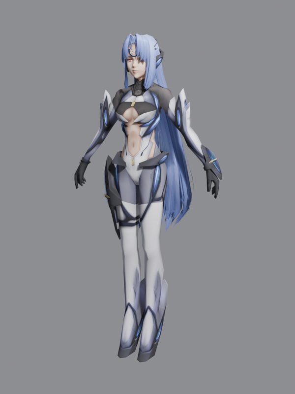

# Models in Blender



The kit turns every model on the disc into a `.glb` file, and any one of
them into a `.blend` that opens ready to look at: textures packed inside,
Material Preview on, the view framed on the model. The commands read the
ISO itself, any region (USA Disc 1/2, Japan Disc 1/2, the May 2006
prototype); nothing to dump first.

## The quick way: a ready-made .blend

```sh
python cli.py blend --iso "Disc 1.iso" --path 'mdl\chr\pc\C3kosmos00.chr' --out kosmos.blend --open
```

or, from a `.glb` you already have:

```sh
python cli.py blend --glb kosmos.glb --out kosmos.blend --open
```

`--open` starts a new Blender window on the file. Leave it off and
double-click the `.blend` yourself (or File ▸ Open in Blender).

What the command does: it runs Blender in the background (no window),
starting from Blender's factory settings so your own startup file and
add-ons cannot get in the way. It deletes the default cube, imports the
model with its textures packed into the `.blend`, removes the bone
display shapes (see "Balls everywhere" below), draws the skeleton as thin
sticks, switches every 3D view to **Material Preview**, frames the model,
points the default camera at it, and saves. Then it opens the saved file
in a second background run and checks it: one armature for a skinned
model, one mesh object per mesh in the `.glb`, every image packed, no
bone shapes, Material Preview. The command fails if any check fails.

Blender is found automatically: on macOS in `/Applications/Blender.app`
(or `~/Applications`), on Windows under `Program Files\Blender
Foundation\` (newest version), on Linux as `blender` on the PATH. Point
it elsewhere with `--blender PATH` or the `XS3_BLENDER` environment
variable.

Extras:

* `--render kosmos.png` also renders the camera view to a PNG
  (Workbench, with texture colours). `--engine eevee` renders with Eevee
  instead; the picture at the top of this page is
  `--render ... --engine eevee`, 960×1280, scaled down.
* `--dump DIR --path ...` works on a dump folder instead of an ISO.

Tested with Blender 5.4.0 Alpha on macOS: KOS-MOS (USA and Japanese
Disc 1), the Japanese `C3kosmos02` (one of the meshes that differ between
the regions), a field map (`mdl\map\cf\E3_ELS01.map`) and a menu mesh
(`mnu\umn.pxy`). The Windows and Linux Blender lookup has not been run on
those systems, and `--open` was not exercised in testing.

## Once it is open

* **Grey model?** The 3D view is in Solid shading. Press `Z` and pick
  **Material Preview**, or click the third of the four sphere buttons at
  the top right of the 3D view. The `.blend` from `blend` already opens
  in Material Preview; a `.glb` imported by hand does not.
* **Can't find the model / it is off screen?** Hover over the 3D view and
  press `Home`, or use **View ▸ Frame All**. On a Mac laptop without a
  `Home` key: `Fn` + `←`, or the View menu. With the model selected,
  **View ▸ Frame Selected** (numpad `.`) zooms onto it.
* **Orbit / pan / zoom without a middle mouse button:** Edit ▸
  Preferences ▸ Input ▸ **Emulate 3 Button Mouse** (then `Option`-drag
  orbits), or use the gizmo at the top right of the 3D view (drag the
  axis ball to orbit, the hand to pan, the magnifier to zoom). A trackpad
  orbits with two fingers and zooms with a pinch.
* **Posing:** click the armature (the thin sticks), switch to Pose Mode
  (`Ctrl`+`Tab`), select a bone, press `R` to rotate.

## Balls everywhere? (importing a .glb by hand)

If you import a `.glb` yourself (File ▸ Import ▸ glTF 2.0), Blender's
glTF importer gives every bone a custom display shape: a small sphere
(an `Icosphere` kept in a hidden collection called `glTF_not_exported`).
KOS-MOS has 78 bones, so you get 78 balls floating over her, and in Solid
shading they can look like the whole model. They are only how the bones
are drawn; the mesh is underneath. To avoid them:

1. In the import dialog, open the **Bones & Skin** section and tick
   **Disable Bone Shape**. (The importer only makes the shapes with
   **Bone Dir** set to its default, Blender; Temperance or Fortune also
   avoids them. Checked in the Blender 5.4 importer's source; versions
   without the option may draw bones differently.)
2. Or, after importing: select the armature, Object Data properties (the
   little running-figure tab) ▸ Viewport Display ▸ **Display As: Stick**,
   and in Pose Mode, Bone properties ▸ Viewport Display ▸ Custom Shape ▸
   clear **Custom Object** for the bones (or just use `blend`, which does
   all of this).

Then press `Z` ▸ **Material Preview** to see the textures.

A note for script users: `open -a Blender --args --python script.py`
does nothing if Blender is already running (macOS hands the request to
the open copy, which ignores the arguments). Build the scene in a
separate background process and open the saved file instead, which is
what `blend` does:

```sh
/Applications/Blender.app/Contents/MacOS/Blender --background --factory-startup --python build.py
```

## Every model at once (.glb)

```sh
python cli.py models --iso "Disc 1.iso" --out out/models          # every model
python cli.py models --iso "Disc 1.iso" --out out/models --filter kosmos
```

The files land in `out/models/`, laid out like the disc
(`mdl/chr/pc/C3kosmos00.glb`). All 1,609 models of a disc take two to
four minutes on an 8-core machine. `out/models/models.csv` lists each
one: its vertex and triangle counts, the header's own triangle count,
joints, skeleton version, how many textures it carries, and whether every
numeric check passed. Give `--iso` more than once (Disc 1, Disc 2, the
prototype, the Japanese discs) and each disc gets its own `disc1/`,
`disc2/` ... folder. The sweep reads each disc through its own index, so
a Japanese disc gives its own versions of the models that differ by
region (`C3kosmos02`, `C3kosmos03`, `C3shion08`, `E3obj136`,
`E3obj298`-`302` and some field maps).

One model as a `.glb`:

```sh
python cli.py model --iso "Disc 1.iso" --path 'mdl\chr\pc\C3kosmos00.chr' --out kosmos.glb
```

`--dump DIR` instead of `--iso` works on a dump folder laid out like the
disc. In the browser the same output comes from the **Models** kind.

## What you get

* The mesh, its UVs and its textures, one PNG per texture the model
  uses, inside the `.glb` (nothing to relink).
* Vertex colours, in the `Color` attribute. On characters that is the
  game's baked tint; on field maps it is the baked lighting.
* Skin weights and an armature for every skinned model with a skeleton
  (about 1,000 per disc). The bones sit on the mesh: select the armature,
  switch to Pose Mode, rotate a bone. KOS-MOS stands 1.71 m tall, Y up,
  and lands upright on Blender's floor.

Where to look first:

| Folder under `mdl/` | What is in it |
|---|---|
| `chr/pc/` | the party: `C3kosmos00`, `C3shion00`, `C3allen00`, `C3momo00`, `C3jr00`, `C3jin00`, `C3ziggy00`, `C3chaos00` ...; other numbers are other outfits and scenes; there are also `C3*H*` and `C3*L*` variants (what the letters stand for is not established) |
| `chr/npc/`, `chr/cit/`, `chr/cfn/` | other characters |
| `ene/` | enemies and bosses |
| `rob/` | E.S. and A.G.W.S. mechs |
| `wpn/` | weapons (`kosmos_lc01.wpn` and so on) |
| `obj/` | props |
| `map/cf/`, `map/ev/` | field maps (towns, dungeons, event sets) |

Standalone meshes outside `mdl/` (menu models under `mnu/`, minigame
models under `mg1/`) are swept too.

## What to expect

* **Characters move; maps do not.** `model` and `models` add the
  same-named motion clips (`pac\cf\` field, `pac\bat\` battle, a weapon's
  own clips) as one action per clip at 30 fps; see [MOTION.md](MOTION.md)
  for picking an action. Set the scene to 30 fps before importing. Hair
  and coat chains stay stiff (the game simulates them), and nothing has
  been compared with the running game yet.
* **Bones have numbers, not names** (`t00`, `t01`, ...). The skeleton
  files carry no joint names.
* **Materials are double-sided and character faces follow the normals.**
  The game mostly draws without culling, so the triangle order cannot be
  trusted for facing; the exporter turns each triangle to face along its
  vertex normals, as the Episode II kit does.
* **Field maps are unlit.** Their meshes carry no vertex normals, only
  baked vertex colours. They are written with the `KHR_materials_unlit`
  extension and no normals, so Blender shades them flat. If the baked
  colours do not show, plug the `Color` attribute into Base Color (or
  multiply it in). Colours are clipped at 128 = full brightness, so
  over-bright baked light is lost.
* **Some map textures look noisy.** About twenty textures per field map
  take their palette from run-time state that is not on the disc.
* **Two models** (`mdl\obj\E3obj287.chr` and `mdl\rob\npr\M3_npcr15.chr`)
  have 125 vertices that use a matrix slot past the end of their node's
  joint list. Those vertices are left on the skeleton root (they do not
  follow any bone); the `.glb` lists that in its `extras.warnings`.
* **20 packages have no mesh**, and the CSV says `empty`. The data
  really is empty: 19 maps are 128-byte stubs, and `shion_sp01a.wpn`
  holds only a motion. Nothing is lost.
* **Animated map parts come at rest.** 310 maps carry a second mesh, the
  pxy at header +0xD0 (ships, rubble, crystals, moving floors). It is
  exported under a node named after it. Its motion (the `PAM` block) is
  not decoded yet, so those parts sit in their rest pose. `E3_HAK16.map`
  and `E3_HAK01_EV03` keep their whole mesh there. They used to be
  `unexplained` and now convert. `E3_HAK16` is wrapped in a large `BG`
  shell, so hide `BG` to see the floors inside.
* **Not yet checked against the running game:** whether models are
  mirrored, the colour scale, and which materials should be transparent.
  If something looks wrong in one of those ways, that is a real report:
  please open an issue.

How the format works, and how each part was proven:
[MODELS.md](MODELS.md).

## From Python

```python
import models_sweep, pxy

src = models_sweep.open_source("Disc 1.iso")          # any region; or a dump folder
p, textures, skeleton = models_sweep.load_package(src(r"\mdl\chr\pc\C3kosmos00.chr"))
print(pxy.check(p, textures.entries)["failed"])       # [] when every check passes
open("kosmos.glb", "wb").write(pxy.to_glb(p, textures, skeleton, "C3kosmos00"))
```

And a `.blend` from Python:

```python
import blend
res = blend.build("kosmos.glb", "kosmos.blend", render="kosmos.png")
print(res["verify"]["failed"])                        # [] when every check passes
```
