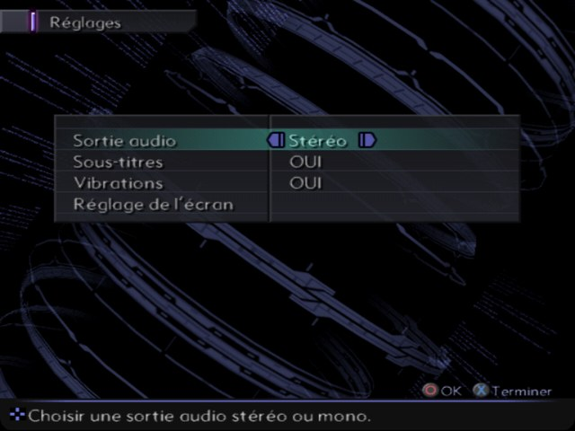
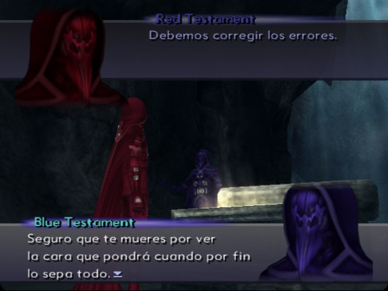
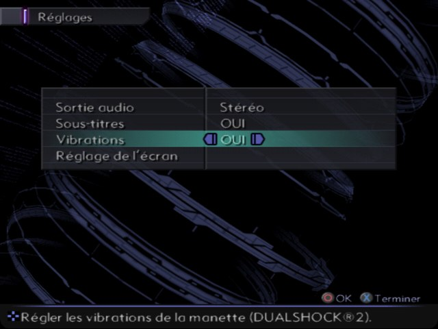
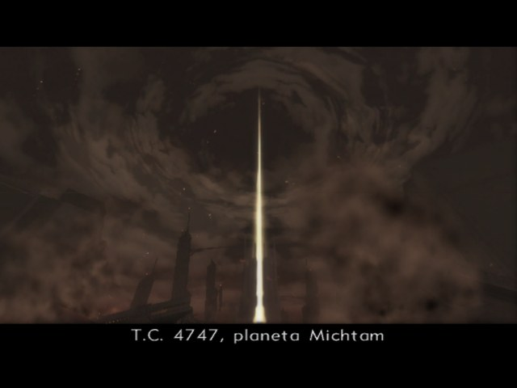
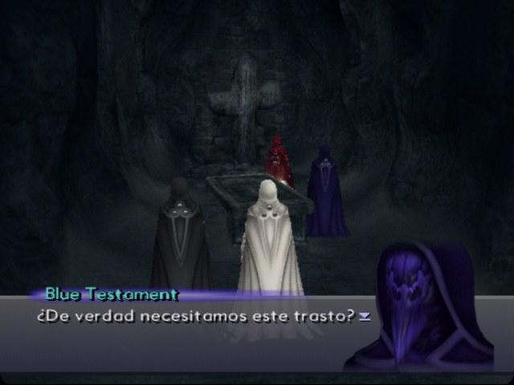
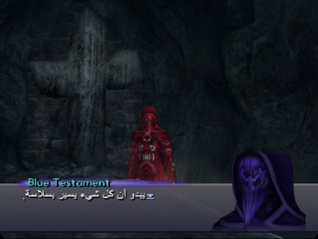
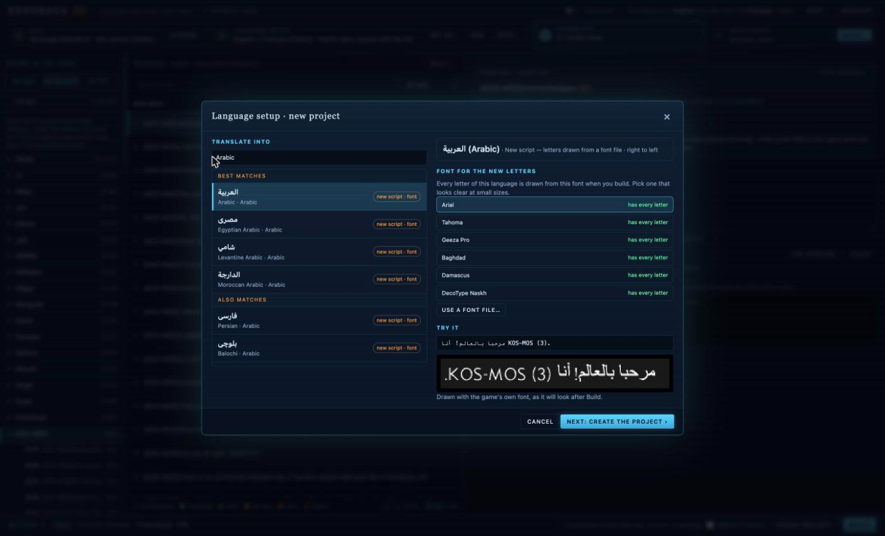

# The Xenosaga III langkit

Play Xenosaga Episode III in your own language. The langkit is the part of
the Xenosaga III Python Extractor made for translators. Open the
translation editor, pick your discs and a language, and start typing. When
you press **Build**, it writes a patched copy of Disc 1 and Disc 2 that boots
like the original, now speaking your language.

Every picture on this page comes from your kind of setup: the editor
running on the retail discs, and the game itself in PCSX2, booted from discs
the editor built.

| | |
|---|---|
|  |  |
| *French menus* | *Spanish in a cutscene* |

## French menus

The game's own Settings screen, translated in the editor and drawn by the
game. The accents come straight from the game's own font. The three letters
it lacks (œ, Œ, Ÿ) are added for you when you build.

| | |
|---|---|
|  |  |
| *Sortie audio, Sous-titres, Vibrations* | *Every help line follows the cursor* |

## Spanish cutscenes

The opening of the game in Spanish: the location caption over the first
real-time scene, then the conversation between the two Testaments. ¿, ñ and
the accented vowels are all in the game's font.

| | |
|---|---|
|  |  |
| *The opening caption* | *Blue Testament's first questions* |

## New alphabets

For a language the game was never written for, the editor draws each new
letter from a font you choose and adds it to the game's font. Arabic runs
right to left with its letters joined, Devanagari keeps its conjuncts, and
Chinese characters are sized like the Japanese release's kanji.

| | |
|---|---|
|  |  |
| *Hindi (Kohinoor Devanagari)* | *Traditional Chinese (Hiragino Sans GB)* |
|  |  |
| *Arabic, joined and right to left* | *Cherokee syllabary* |

There are more captures on the
[front page](../README.md#translating-into-another-alphabet), made with the
command-line tools: Amharic, Georgian, Japanese on the USA disc, and Hindi
movie subtitles.

## The editor

| | |
|---|---|
|  |  |
| *Translating the opening scene. The preview uses the game's own font and the width of the game's window.* | *Language setup: pick a language and see a test line as the game will draw it* |
|  |  |
| *By speaker: everything one character says, scene by scene* | *The first start walks you through four steps* |

### Four steps

1. **Disc.** Pick either disc of your set, USA or Japan. The editor finds the
   other disc, so one project covers both. The first read takes about half a
   minute; after that the list opens in about two seconds.
2. **Language setup.** Choose from 382 languages. The editor tells you what
   each one needs:
   * **Ready:** the game's font has every letter (Spanish, Italian and
     Portuguese on the USA discs).
   * **Ready, a few letters added:** the editor draws the missing letters
     from DejaVu Sans, which comes with the kit (French and German, for
     example).
   * **New script:** you pick a font from a list of the ones on your
     computer that have every letter. The editor then draws each new letter
     into the game's font.
3. **Translate.** Lines are grouped the way you meet them in the game. The
   Story groups hold voiced scenes, field dialogue, townspeople, choices,
   narration, system and battle messages, and movie and event subtitles.
   Further groups cover the Episode I and II recap, menus, the database, and
   battle names and descriptions. You can also browse by speaker or by file.
   As you type, the editor checks each line. It makes sure that:
   * every game code is kept;
   * every letter can be drawn;
   * the page stays within the game's 16,000-byte limit;
   * the line fits the width of its window.

   *Wrap to fit* breaks long lines for you.
4. **Build.** *Check project* runs the build's checks over everything first.
   Build then writes both patched discs into a folder of your choice and
   reads every changed file back to confirm it.

The editor knows which strings the game actually draws. It reads what each
scene script's code does with every string, so you see the lines players
see. The USA discs also hold 73,601 developer debug prints; those stay
tucked away. When a townsperson waits for a keyword, the editor keeps the
keyword in step with the word in their line.

Your work saves as you type, with automatic backups and checkpoints you can
go back to. For spreadsheets, there is TSV export and import.

## Battle text

Battle text is in the editor too:

* **Battle names and descriptions:** 2,484 lines covering the battle
  commands (Attack, Tech, Ether…), enemy names, techs, ethers, items and
  equipment.
* **Battle messages and banners** from the battle scripts.
* **Battle voice subtitles.**

The battle HUD's bitmap letters are pictures rather than text. The
`statfont-export` and `statfont-import` commands handle those.

## Getting it

* **On its own:** download
  `Xenosaga3-Translation-Editor-<version>-win64.zip` from the
  [releases page](https://github.com/LinuxJessi/Xenosaga3PythonExtractor/releases).
  On macOS, `python build.py --editor` builds
  `Xenosaga-III-Translation-Editor.app`. Double-click it and the editor opens
  in your browser, ready to go.
* **From a checkout:** double-click `translate.command` (macOS),
  `translate.bat` (Windows) or `translate.sh` (Linux), or run
  `python gui.py --editor`.
* **From the extractor app:** use the **Translation editor** button in the
  header.

The editor lives at `http://127.0.0.1:21389/editor`. It uses the same
address every time, so your browser remembers your disc and project between
sessions.

## How it is tested

The kit's own tests run on the real USA and Japan discs. They read every
line, confirm that each original line encodes back to the same bytes, and
build an unedited project into byte-identical discs. They also build test
projects in a ready language, in French with letters added, and in Russian
with a chosen font, then read each one back object by object. They confirm
that the editor refuses lines the game could not draw. To run them on your
own discs, use `python cli.py tx-selftest --iso DISC1.iso`.

In the game, the editor's builds have shown French menus, Spanish cutscenes,
and Hindi, Chinese, Cherokee and Arabic dialogue. All of these were on USA
Disc 1 (the captures above). Next on the list are battles, Disc 2 and the
disc swap, and the Japanese discs. Boot your build in an emulator before you
share it, and please tell us what you find:
<https://github.com/LinuxJessi/Xenosaga3PythonExtractor/issues>.

The editor began as the Episode I kit's translation editor. It has the same
page, project file, backups and language list, with Episode III's own readers
and writers underneath.
[TRANSLATION-EDITOR.md](TRANSLATION-EDITOR.md) is the full reference, and
[TRANSLATING.md](TRANSLATING.md) covers the command-line route.
