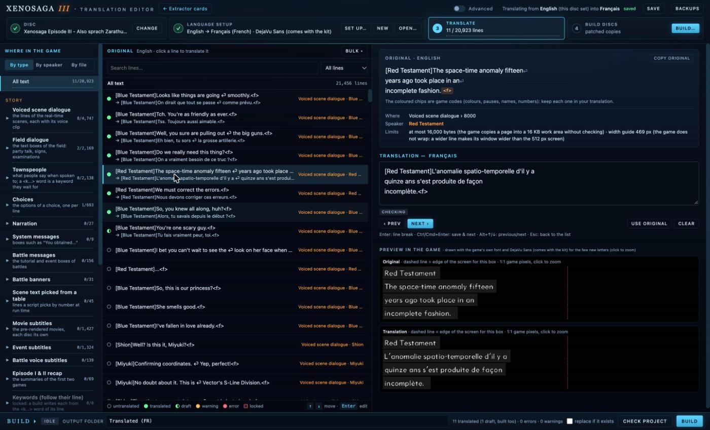
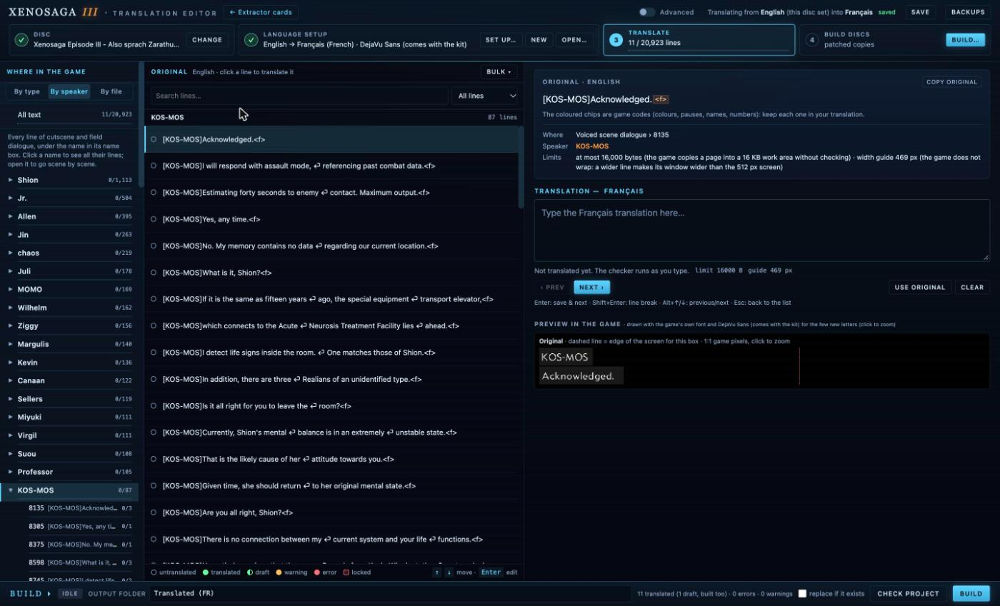
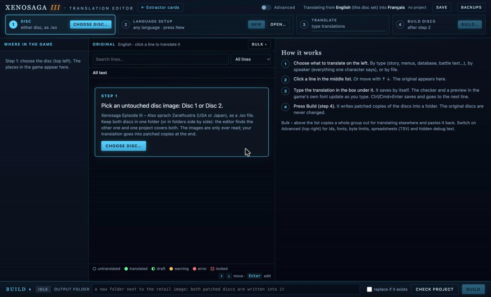
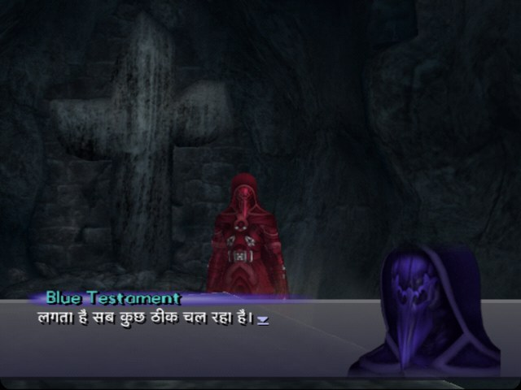
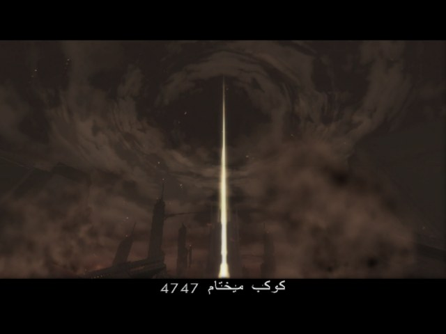

# The Xenosaga III langkit

*A translator's tour of the kit's translation tools. The reference for the
editor is [TRANSLATION-EDITOR.md](TRANSLATION-EDITOR.md); the command-line
way is [TRANSLATING.md](TRANSLATING.md); new alphabets in depth are
[SCRIPTS.md](SCRIPTS.md).*

The langkit is the part of the Xenosaga III Python Extractor that puts
Episode III into another language. It has two faces:

* **The translation editor**: one page in your browser. Pick your discs and a
  language, type translations, press Build. It writes patched **copies** of
  Disc 1 and Disc 2. Your retail images are only ever read.
* **The commands under it** (`text-export` / `text-import`, `lang`, `font-*`,
  `glyphs-*`, `patch`). Use them for scripted or very large jobs.

It works for languages the game's font already draws, such as Spanish or
Italian. French and German need a few letters added, which happens by itself.
It also works for alphabets the game never had: Arabic and Hebrew right to
left, Devanagari, Cherokee, Chinese, and any other script HarfBuzz can shape.
It knows 382 languages.

**The kit ships no game data.** You need your own discs. Every picture on
this page is a screenshot of the editor running on the retail discs, or a
PCSX2 capture of a disc the editor built. Nothing is retouched.

## The editor

| | |
|---|---|
|  |  |
| *Translating the opening scene into French. The preview is drawn with the game's own font, using the width the game gives that window.* | *Language setup: Arabic, a font for the new letters, and a test line drawn right to left as it will look after Build* |
|  |  |
| *By speaker: everything one character says, scene by scene* | *First start: four steps, from disc to built copies* |

### Four steps

1. **Disc.** Pick either disc of your set (USA or Japan). The editor finds the
   other disc, and one project covers both. The first read takes about half a
   minute; after that the list loads from a cache in about two seconds.
2. **Language setup.** Pick the language. The editor says what your language
   needs:
   * **Ready:** the game's font draws every letter (Spanish, Italian, Portuguese
     on the USA discs).
   * **Ready, a few letters added:** French needs `œ Œ Ÿ` and German needs a
     few letters. They are drawn from DejaVu Sans, which comes with the kit,
     so there is nothing to choose.
   * **New script:** every letter is drawn from a font file you pick from a
     list. The list shows only fonts that have every letter.
3. **Translate.** The lines are grouped by what they are. Under Story you get
   voiced scene dialogue, field dialogue, townspeople, choices, narration,
   system and battle messages, and movie and event subtitles. There are also
   groups for the Episode I and II recap, menus, the database and battle names.
   You can also browse by speaker or by file. Each line is checked as you
   type:
   * game codes kept;
   * every letter drawable;
   * the 16,000-byte page limit (the game copies a page into a 16 KB work area
     and does not check the size);
   * a width guide read from the game's window code.

   The game never wraps lines, so *Wrap to fit* breaks a line to the width
   guide for you.
4. **Build.** *Check project* first runs the build's own checks over the whole
   project, with nothing written. Build then writes both patched discs into a
   folder and reads every changed file back.

Scene-script strings are sorted by what the script's **code** does with them.
The USA discs' 73,601 debug prints, which the game never draws, stay out of
your way. A townsperson's keyword (the word they wait for) is kept equal to
the `<k…>` word in its line.

Your work is saved as you type. Each project has automatic backups and
checkpoints you can restore. TSV export and import are there for working in
a spreadsheet.

## In the game

All of these are captures from PCSX2. Each disc was built by the editor from
a project, then booted for a New Game. The first four are the first dialogue
box of the game (Blue Testament, about two and a half minutes in).

| | |
|---|---|
|  |  |
| *Hindi (Kohinoor Devanagari)* | *Traditional Chinese (Hiragino Sans GB), 2026-11-27 build* |
|  |  |
| *Arabic, joined and right to left* | *Cherokee syllabary* |
|  | |
| *An Arabic location caption over the real-time opening* | |

The first Chinese build showed thin vertical lines between characters. The
Han glyphs had been drawn at the size used for other scripts, so they filled
the font cell edge to edge. The game's filtered draw then picked up the
neighbouring cells. The Japanese retail font leaves a margin around its
kanji. Han, kana and Hangul are now drawn at that size by default, and the
rebuilt disc (above) is clean.

More captures, from the command-line tools (Amharic, Georgian, Japanese on
the USA disc, Hindi movie subtitles), are on the
[front page](../README.md#translating-into-another-alphabet).

## Getting it

* **On its own:** `Xenosaga3-Translation-Editor-<version>-win64.zip` on the
  [releases page](https://github.com/LinuxJessi/Xenosaga3PythonExtractor/releases).
  On macOS, `python build.py --editor` builds
  `Xenosaga-III-Translation-Editor.app`. Double-click it and the editor opens
  in your browser. It needs nothing else, and the extractor cards are left out.
* **From a checkout:** double-click `translate.command` (macOS),
  `translate.bat` (Windows) or `translate.sh` (Linux). You can also run
  `python gui.py --editor`.
* **From the extractor app:** use the **Translation editor** button in the
  header.

The editor keeps the address `http://127.0.0.1:21389/editor`, so your browser
remembers your disc and project between launches.

## What is checked, and what is not

The kit's own tests run on the real discs (USA and Japan, both discs each).
They cover:

* every row read;
* every original line encoding back to its own bytes;
* an unedited project building byte-identical discs;
* builds in a ready language, in French with letters added, and in Russian
  with a chosen font, each read back object by object;
* refusals for lines the game could not draw;
* builds from the stand-alone app.

`python cli.py tx-selftest --iso DISC1.iso` runs these on your own discs.

In the game: Hindi, Chinese, Cherokee and Arabic builds on USA Disc 1 (the
captures above). **Not booted yet:** Disc 2 and the disc swap, the Japanese
discs, a French build, and menu and battle text from an editor build. Please
boot your build in an emulator before you share a patch, and open an issue
if something looks wrong:
<https://github.com/LinuxJessi/Xenosaga3PythonExtractor/issues>.

The editor began as the Episode I kit's editor, so it has the same page,
project file, backups and language list. Under it are Episode III's own
readers and writers. [TRANSLATION-EDITOR.md](TRANSLATION-EDITOR.md#modules)
lists what is the same and what differs.
