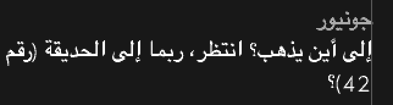
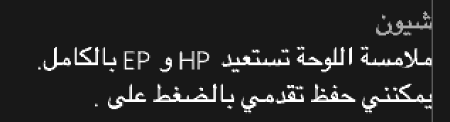
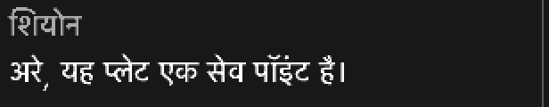
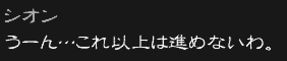
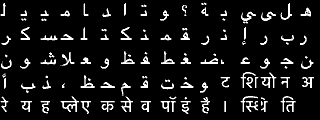
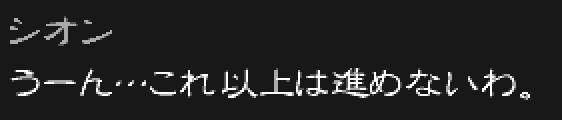

# Translating Episode III into another script: Arabic, Hindi, Japanese on the USA disc, and others

> **Partly tested in game (2026-11-20).** Two USA Disc 1 copies built with
> `lang import` booted in PCSX2 2.9.175: Arabic (68 new glyphs, joined and
> right-to-left, in scene dialogue, the synopsis screen and the field menu) and
> Japanese on the USA disc with `--unlock jp` (donor kana, the USA font's own
> kanji, and retail Latin-1 such as `®` still drawn right after re-coding).
> Captures and caveats: [UPDATES.md](UPDATES.md). The images directly below
> are still kit previews. Not booted: `--extend` (Hindi), `--reclaim-latin`,
> subtitles in a new script, the Japanese build.

The game draws text one cell at a time, left to right, from a bitmap font
(`mnu\us\font0.bin` / `font1.bin`, see [FONT.md](FONT.md)). The font has no
idea of joining forms, right-to-left order, conjuncts or letters it never
had. `langpack.py` does all of that when the disc is built, so the game only
ever sees a stream of glyph codes. This is how console fan translations of
right-to-left scripts have always worked. The pipeline is borrowed from the
Episode I kit (`Xenosaga1PythonExtractor/langpack.py`) and rebuilt on
Episode III's own font addressing, slot model and text tree.

| | |
|---|---|
|  |  |
|  |  |

Every image above is a `lang preview --iso` of a string read back from a
patched copy of USA Disc 1. It is drawn through that copy's own executable
rules and rebuilt font file (§ 5); it is not an emulator capture. The grey line
above each box is the speaker name, which the game shows separately.

Requirements: `numpy`, `Pillow`, `fonttools` and `uharfbuzz` (all in
`requirements.txt`; the launchers install them). You also need a TrueType or
OpenType font for your script. Any free one works: Noto Naskh Arabic, Noto
Sans Devanagari, or on a Mac `GeezaPro.ttc`, `Kohinoor.ttc`,
`SFGeorgian.ttf`.

## 1. Export the text

```sh
python cli.py text-export --iso D1.iso --iso D2.iso --out tr/en
cp -R tr/en tr/ar        # translate tr/ar
```

The tree is described in [TRANSLATING.md](TRANSLATING.md). It contains:

- `### KEY` block files for `.sb` scenes, menus (`.txd`), the `mnu` databases,
  `Message.Dat` and `batdat.bin`;
- whole files for subtitles and `.mes` messages.

To read a scene before translating it, `python cli.py dialogue --iso D1.iso
--iso D2.iso --out lines/` writes each script's lines in the order its code
shows them, each with its block number (`[#0114]` is `### 0114`). Two things
it shows that the tree does not ([DIALOGUE.md](DIALOGUE.md)):

- a townsperson's keyword is stored twice, inside the line as `<knot ready>`
  and alone as `not ready`, and the script matches them as text: translate
  both the same way;
- many `dialogue` blocks of a scene (`--- main ---`, `start`) are the
  developers' debug prints and never reach the screen.

Write the translation in **logical order**, the way you type it. Do not reverse
anything, do not type presentation forms, and only break lines where you want a
break.

Leave these exactly where they are. `langpack` passes them through without
shaping, mirroring or wrapping across them:

| What | Examples | Treatment |
|---|---|---|
| `$`-commands | `$col707070;` `$prop1;` `$ay375;` | The executable's 18 command names. |
| Ruby spans | `$rubys; … $rubye;`; on the Japanese build also `[base/reading]` in subtitles | Kept as one unit. |
| Script tags | `<f>` `<w45>` `<l2>` `<colc16060>` `<kGnosis>` `<○>` `<R1>` | Passed through as written. |
| Escaped control bytes | `⟦19⟧⟦03⟧`, `⟦15⟧⟦02⟧⟦04⟧⟦07⟧` | Kept together with their operands. Operand lengths come from the executable's table at 0x4B3150; 0x08 and 0x15 have variable length. |
| Line breaks | `\n` typed as backslash-n; `⟦0D⟧⟦0A⟧` in menus | Hard break. |
| Speaker prefix | `[Shion]` at the start of a dialogue string | Translate the name if you like. It is encoded on its own and always stays first. |

Tag position:
- printer tags (`<f>` `<wN>` `<lN>` `<xN>` `<sN>` `<col…>`) and `$`-commands
  before the first word of a paragraph stay first; after the last word
  (`<w45><f>`) they stay last; between words they travel with the word that
  follows them;
- every other tag draws something (button marks `<○>` `<×>` `<△>` `<□>`,
  keywords `<Shion>` `<kGnosis>`). It is placed by the bidi pass like a word:
  a keyword reads as its letters, a button mark as punctuation. So in
  `اضغط على <○>.` the full stop lands on the far (left) side of the button.
  Its width counts as its text.

A colour span such as `<colc16060>two words<cole>` inside a right-to-left line
is not re-paired after reordering. Keep a coloured span within one word, or
check the preview.

## 2. Build the glyphs: `lang scan`

```sh
python langpack.py lang scan --iso D1.iso --text tr/ar \
    --font /System/Library/Fonts/GeezaPro.ttc --script Arab --language ar --rtl --out tr/pack
```



`scan` reads every string in the build's display codec: `us` on USA and the May
2006 prototype, `jp` on Japan. It skips identifiers, the developers' cp932 /
EUC notes, the pse director scripts and `fixed` nj blocks.

**Target-script characters.** A character is target script when the build
cannot already draw it, meaning the display codec refuses it. Examples:
- Arabic, Cyrillic or kana on USA;
- Arabic or Devanagari on Japan. Cyrillic and Greek are already in the Japanese
  font's JIS rows, so on Japan they stay as typed.

A paragraph that has no target character is copied byte for byte. That is why
`encode` on an untranslated tree changes nothing.

**Shaping.** Each target run is shaped with HarfBuzz:
- a single glyph becomes one cell;
- a cluster (base plus marks, or a conjunct) up to 18 px wide becomes one cell;
- a wider cluster is cut into 17 px strips that abut exactly.

**Slots.** Each glyph gets a slot from the build's slot model
(`glyphs.SlotModel`; FONT.md § New glyphs):
- **proportional** slots first: drawn at cell + 0x240 with a metric pair;
- **wide** cells (19 px) after that.

The same glyphs are drawn into both fonts. `scan` writes a *pack*:

| file | what |
|---|---|
| `glyphset.json` | which glyph key has which cell and code; keep it, later runs reuse the codes |
| `font0.bin`, `font1.bin` | the rebuilt fonts, same size as retail (patched in place) |
| `glyphs.png` | the placed glyphs, for a look |
| `langpack.json` | the options, the region, the retail addressing and the slot model, so `encode` needs no disc |
| `donor_font0.bin` | only with `--donor` |

`cli.py patch` and the `lang` commands become part of `cli.py` once the
integrator lists `patch` and `langpack` in its module lists. Until then, run
`python langpack.py lang ...` directly.

Free room measured on the discs (`glyphs-slots`):

| build | proportional | wide |
|---|---|---|
| USA Disc 1 | 123 | 51 |
| USA Disc 1, `--reclaim-latin` | 186 | 51 |
| USA Disc 1, `--unlock jp` | 72 | 3,149 (2,965 of them kanji cells) |
| Japan Disc 1 | 51 | 1,302 |

On Japan, "free" means retail text does not draw the cell. No reachable cell is
blank, so new glyphs overwrite unused symbols and JIS kanji that retail text
never uses.

**Spacing.** `--spacing font` is the default. It gives each proportional glyph
the advance its TrueType font asks for, using `right = advance - 2` with left =
1 and the raster kept unshifted, so joining scripts touch.

`--spacing ink` gives the retail look instead: ink plus 2 px, so every glyph
has a 1 px gap on each side. Arabic then visibly breaks apart.

The draw offset of a proportional image is not traced in the printer. The
preview assumes `pen + 1 - left`, as Episode I's printer does.

Sizes: `--px 20 --baseline 17` (the defaults) suit most fonts in the 20×24
cell. For Devanagari, `--px 17 --baseline 16` keeps stacked marks inside the
cell.

Script tags are HarfBuzz / ISO 15924: `Arab`, `Hebr`, `Deva`, `Beng`, `Geor`,
`Armn`, `Thai`, `Cyrl`, … Pass `--rtl` for Arabic, Hebrew, Syriac and Thaana.

**Characters the build reads but draws blank** (the Japanese retail gap 縊
E5D0, for example) stay as typed, and `encode` lists them. textpack's font
check refuses them in an edited string.

### Two scripts in one font pair: `--extend`

```sh
python langpack.py lang scan --iso D1.iso --text tr/ar --font GeezaPro.ttc --script Arab --rtl --out tr/pack-ar
python langpack.py lang scan --iso D1.iso --text tr/ar --extend tr/pack-ar/glyphset.json \
    --font Kohinoor.ttc --face 0 --script Deva --language hi --px 17 --baseline 16 --out tr/pack
```

A pack can hold several fonts. Each run goes to the first font that has all of
its characters, so one tree can mix scripts:
- the first scan leaves runs its font lacks for a later `--extend` (and says
  so);
- the second scan keeps every slot already given out, with the same cells and
  codes, and adds its own glyphs;
- `encode` with the last pack handles both scripts.

### Japanese on the USA build: `--donor`

```sh
python langpack.py lang scan --iso US-D1.iso --text tr/ja --donor JP-D1.iso --out tr/pack-ja
```

`--donor` takes a character's image from another Episode III disc's font0:
- the Japanese disc's own kana, kanji and punctuation, as the game drew them;
- any character the donor does not draw falls back to `--font`.

Without an unlock, every kana and kanji takes one of the USA build's free slots
(174 in all). That is enough for a line or a menu, not for a script. With
`--unlock jp` (next section), kanji need no slot: the USA font still holds all
2,965 JIS kanji cells, and the unlocked gate reaches them by their own EUC
codes. Only kana and symbols take slots.



### Executable unlocks (USA / prototype): `--unlock`

These are `glyphs.UNLOCKS`, described in FONT.md:

| mode | patch | effect |
|---|---|---|
| `jp-gate` | The pair gate at 0x181E48 becomes the Japanese one (lead ≥ 0xA0). | Opens the kanji rows B0-CF and the A5 katakana codes. |
| `jp-prop` | The prop gates at 0x1856E4 and 0x182DD4 change from 0x180 to 0xC0. | Cells 192-383 become fixed width. |
| `jp` | Both. | |

**The cost of `jp-gate`.** Every Latin-1 byte (é, ö, ®…) becomes a pair lead,
so `encode` re-codes **every display string of the tree**. Each retail
character gets its cell's new code, and the result is written as escapes.

The exit test checks every untouched string of the USA tree: 26,584 strings, of
which 141 are re-coded. Each one draws exactly the same cells through the
patched gate as it did through the retail one.

What the unlock does not reach:
- text outside the tree is **not** re-coded: executable and overlay strings,
  `.xep`. Latin-1 there draws wrong under `jp-gate`;
- `lang import` writes the patched boot executable of each disc
  (SLUS_213.89 and SLUS_214.17) together with the text and the fonts;
- an unlocked disc counts as an unknown build afterwards. Region detection and
  `text-import` refuse it, so make every change in one `lang import` from the
  retail discs.

### Freeing the Latin-1 cells: `--reclaim-latin` (USA)

Retail text uses 68 Latin-1 cells: the 0xA0-0xFF singles, accented letters, ®,
°, and so on. `--reclaim-latin` makes them free; the `$han` ASCII cells always
stay. Use it only for a tree that no longer draws them.

`encode` refuses any display string that still does and lists each one. On the
retail USA tree that includes `ee⟦82⟧P00_00x` labels in `cf\us\8345.sb`.

## 3. Encode: `lang encode`

```sh
python langpack.py lang encode --text tr/ar --pack tr/pack --out tr/ar-enc --width 300 --align right
```

For every string, `encode` does the following:

1. Shapes each target run again and measures every piece with `font.Measurer`
   (FUN_001828a0, in the `$prop1;$han1;` state; `--state` changes it). The
   measurement uses the rebuilt metrics and the exact bytes the game will see.
2. Wraps to `--width` pixels. 0 means only your own breaks. Lines break at
   spaces, and between any two wide characters (Japanese).
3. Puts each line in visual order with the Unicode Bidirectional Algorithm
   (UAX #9). The levels are resolved on the whole paragraph **before** the
   wrap. Then each wrapped line is reordered on its own (rules L1, L2), the way
   a browser does it. So a bracket pair or a number split by a line break still
   resolves as one:
   - right-to-left runs are reversed; Latin words stay forward;
   - numbers follow the weak-type rules: `1,000.5`, `12:30` and `$5` stay
     whole (but do not type `$` in a translation: see the note below). Digits after Arabic letters are Arabic numbers, so a `%` after them
     goes to their left (`مكيلع %50 مالس`); after Hebrew it stays on the right.
     Arabic-Indic digits (`٤٢`) read left to right;
   - brackets are paired (rule N0). `سلام (abc def) ghi` keeps `(abc def)`
     together and right-to-left around it. Every bracket, `< >` and `« »` on a
     right-to-left level is mirrored (rule L4);
   - other punctuation and spaces take the direction of the text on both
     sides, or else the paragraph's;
   - a paragraph with no right-to-left letter stays left-to-right.

   Checked against ICU 78 (`ubidi_writeReordered` with mirroring, and
   `ubidi_setLine` for wrapped lines): about 7,000 random mixed
   Arabic/Hebrew/Latin/number/bracket strings and 5,400 wrapped ones give the
   same display string. A second run (2026-11-20) added the angle brackets
   U+2329/U+232A (paired with their equivalents U+3008/U+3009 the way ICU does
   it), marks right after a bracket (ICU leaves them neutral, unlike the
   letter of UAX #9) and ZWJ/ZWNJ (ICU puts a joiner on the next character's
   level): 150,000 random strings, the joiners included, give ICU's display
   string. In wrapped lines the encoder keeps a mark with the character it
   sits on (one shaped cluster), where ICU moves the mark alone; that is the
   only difference left (8-17 of about 2,640 wrapped random strings per run
   when marks are in the pool). ICU is not a dependency of the kit; the self-test carries 12
   of those reference lines plus 5 level checks.
4. With `--align right`, pads right-to-left lines with spaces (5 px each, the
   `$xx1` default).
5. Writes each glyph as `⟦XX⟧` escapes and updates `<lN>` when the wrap changed
   the line count (only if it matched before).

`--width` and `--align` apply to dialogue, subtitles and `Message.Dat`
(`--layout-kinds sb,subtitle,msgdat`). Menu labels are encoded on one line and
never padded.

The output tree has the input's layout and manifest. Untouched files are
byte-identical, so `text-import` only rebuilds what you translated.

**Do not type `$` as text** (currency, "$5"). For the game every `$` starts a
command (`$col1;`, `$prop1;`, ...). The printer (FUN_00184090) logs an error
for a name it does not know and then draws the `$`, but the width function
(FUN_001828a0, used for centred, right-aligned and wrapped boxes) skips from
any `$` to the next `;`, or past the end of the string when there is none.
The line is drawn but measured wrong. `lang encode` and `lang preview` warn
about every string with a typed `$`, and the preview draws it the way the
printer does. Write the amount without it ("5 dollars", "5 USD").

Box widths are not measured in game yet. FONT.md's menutext check suggests a
hand-wrapped box of about 440 px for menu help; start lower for dialogue.

## 4. Write the discs: `lang import` (or text-import + patch)

```sh
python langpack.py lang import --iso D1.iso --iso D2.iso --text tr/ar-enc --pack tr/pack --out OUT/ --grow
```

This runs `textpack.plan_import` and writes the result, the pack's
`font0.bin` / `font1.bin`, and with `--unlock` both patched executables. All of
it goes in **one** verified copy of each disc (`patch.patch_copy`, see
[REPACK.md](REPACK.md)). The source images are never written.

Placement:
- chain-0 objects (the fonts, menus, `cf` scenes) go on both discs, at the same
  LBA when they grow;
- Disc 1's story chain (most subtitles) goes on Disc 1 only.

`--grow` is needed whenever an object gets larger. That happens often: two bytes
per glyph, and the loader buffer sizes are unknown (TRANSLATING.md).

The same thing in two steps, as the exit test also did:

```sh
python cli.py text-import --iso D1.iso --iso D2.iso --text tr/ar-enc --out STEP1/ --grow
python cli.py patch --iso STEP1/D1.iso --iso STEP1/D2.iso --out OUT/ \
    --set 'mnu\us\font0.bin=tr/pack/font0.bin' --set 'mnu\us\font1.bin=tr/pack/font1.bin'
```

`text-import` accepts an encoded tree because glyph codes are escapes. Its font
check does not judge escapes, and every typed character left is one the build
draws.

## 5. Check without the game: `lang preview`

```sh
# a line from the pack (encode + draw)
python langpack.py lang preview --pack tr/pack --text "[جونيور]إلى أين يذهب؟ انتظر..." --width 300 --align right --out line.png
# a string read back from a patched copy, through that copy's executable and font
python langpack.py lang preview --iso OUT/D1.iso --path 'cf\us\3830.sb' --key 0113 --width 300 --align right --out back.png
```

The preview walks the bytes the way the printer lays them out:
- `$prop` / `$han` and control byte 0x19 set the mode;
- control sequences are skipped together with their operands;
- a fixed cell is 19 px;
- a proportional glyph's image is cell + 0x240, with advance `right - left + 3`.

A code that lands on the wrong cell shows up wrong in the image.

It also prints the encoded text and each line's width. The faint vertical line
marks `--width`.

## 6. Boot it

Three builds made with these commands were booted in PCSX2 on 2026-11-20
(Disc 1 of each; the table, commands and captures are the seventh pass in
[UPDATES.md](UPDATES.md)):

- **Arabic** (68 new proportional glyphs, right-aligned): joined
  right-to-left text on the synopsis screen, the field menu and in scene
  dialogue;
- **Japanese on the USA disc** with `--unlock jp`: the unlocked executables
  boot, and kana, kanji and full-width punctuation draw;
- **a grown text file**, appended past its allocation with `--grow`: it loads
  from its new place.

Still not checked:
- whether the engine wraps proportional text itself, and at what width. The
  dialogue box is wider than the `--width 300` used for the Arabic build, and
  its width has not been measured;
- the page-wait marker in right-aligned dialogue, which is drawn where the pen
  stops, against the first Arabic letter;
- Disc 2 of any build, the Japanese discs and the prototype as targets;
- any script other than Arabic and Japanese in the running game.

A first boot of a new language should check a short line in an early scene,
such as `cf\us\1010.sb` #0001 ("Board the E.S.?"), before anything long.

## Exit tests (2026-11-20)

The script and log are in the round-2 scratch folder (`langpack/exit_tests.py`,
`exit_tests.log`). **16 of 16 passed.** All disc writes went to APFS clones,
which were deleted afterwards.

- **(a) No-op**
  - USA D1+D2 tree, 920 files: `scan` finds 0 glyphs, and `encode` with
    `--width 400 --align right` is byte-identical (0 differ).
  - JP1+JP2 tree, 1,059 files: the same, 0 differ.
- **(b) Arabic into the USA pair**
  - The test strings: a `[Speaker]<l1>…<w15>…<w45>` dialogue, a help line with
    HP / EP and `<○>`, `E.S.؟<f>`, a menu label and a Disc 1 subtitle line.
  - Fonts: GeezaPro, 59 glyph slots (51 single glyphs and 8 strips of wider
    ligatures).
  - `encode` changed exactly the 4 edited files. The dialogue wrapped at 300 px
    gained a `\n`, `<l1>` became `<l2>`, and `<w45>` stayed last.
  - Written with `text-import --grow` followed by `patch` with the fonts.
  - Read back: 6 of 6 strings on the D1 copy equal the encoded bytes. The D2
    copy has the same menu string and both rebuilt fonts. The chain-1 subtitle
    line is on the D1 copy.
  - `lang import` in one step gives the same bytes.
  - The previews from the copy show joined right-to-left Arabic (images above).
- **(c) Devanagari with `--extend`**
  - Kohinoor, `--px 17`, 20 glyphs.
  - All 59 Arabic slots keep their cells and codes. The result is 79 slots, all
    proportional. The Hindi part is 9 single glyphs, 9 base+mark clusters and
    one conjunct cut into 2 strips.
  - One encode handles both scripts. The Hindi line reads back and previews
    correctly.
- **(d) Japanese on the USA build**
  - Without an unlock: 20 donor glyphs from JP Disc 1's font0 (18
    proportional, 2 wide). The line reads back from the D1 copy.
  - With `--unlock jp`: 15 donor glyphs, because 以 上 進 are written as their
    own EUC codes and drawn from the USA font's kanji cells.
  - The re-encode check: 26,584 display strings, 141 re-coded, every untouched
    one on the same cells.
  - Both copies' executables read back as `euc` / 0xC0 / A9 row, and the line
    reads back through the patched executable.

`python langpack.py --self-test` covers:
- with no discs: the synthetic cases (atoms, wrap, `<lN>`, control operands,
  block and subtitle files, unlock re-encode, preview), and the bidi pass:
  12 ICU reference lines (paired and mirrored brackets, numbers, Arabic-Indic
  digits, Latin inside Arabic, Hebrew), a bracket pair split by the wrap, drawn
  tags as inline objects, and English with brackets and numbers coming back
  byte for byte;
- with `XS3_D1` and `XS3_JP1` set: the no-op on the real trees and the unlock
  re-encode check on D1.

## Credits

The approach was first shown for the Xenosaga engine by poketony's
[XS1KOR](https://github.com/poketony/XS1KOR): a TrueType face rendered into the
font cells. The pipeline (shaping, ordering, encoding) is the Episode I kit's,
and the addressing and slot model come from the Episode III executables.
