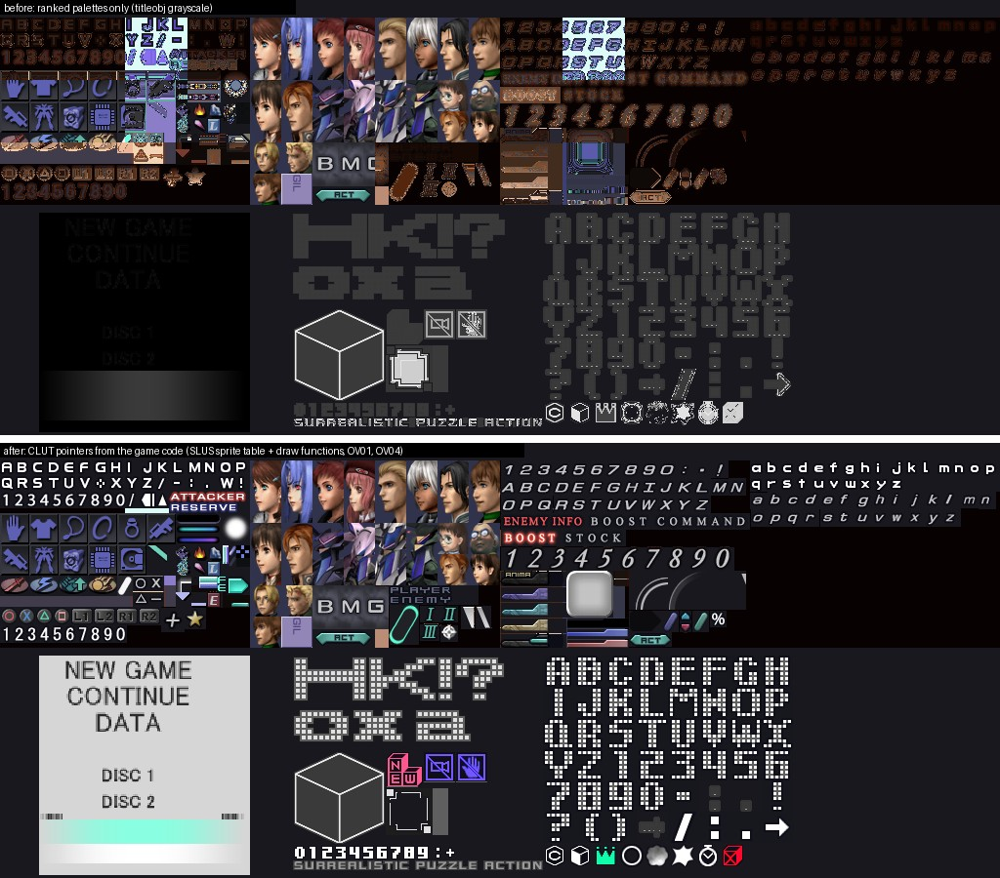
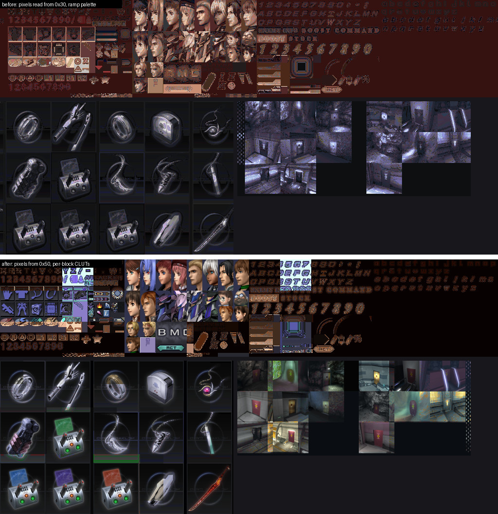
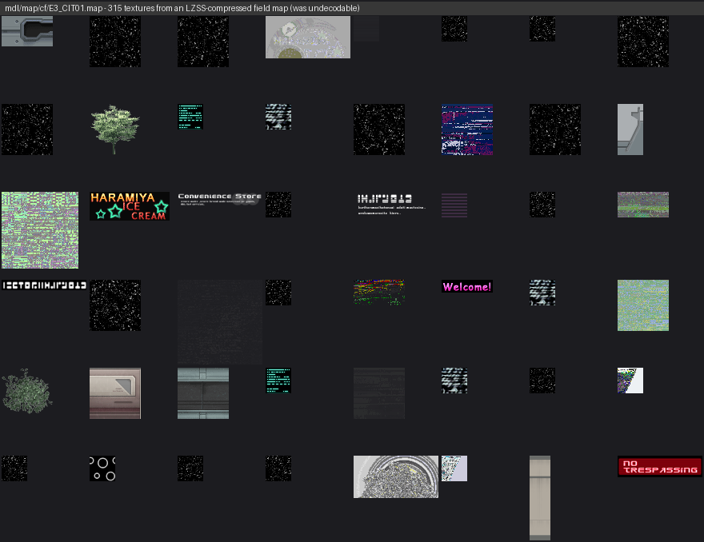
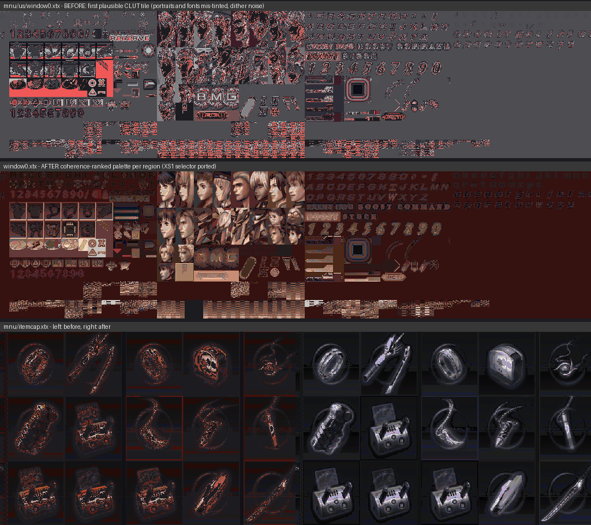

# Updates

Newest first. Each entry lists what changed, why, and what you have to do
to benefit from it. (Same convention as the Xenosaga I kit's
`docs/UPDATES.md`; this file starts with the first improvement run ported
back from that project.)

## 2026-11-27 — Room for Korean, Chinese and other large alphabets

* **New letters no longer run out at 174.** The USA executable has 174 free
  font cells. A whole-game translation into Korean, Chinese, Japanese,
  Amharic or an Indic script needs far more. When a project's letters don't
  fit, the editor's build now opens the font's kanji rows: the `jp-gate`
  unlock, four words of the pair gate, patched on both discs. That gives 193
  proportional and 3,149 wide cells.
* The cost: English strings that use the single bytes 0xA0-0xFF (é, ä, ®…;
  123 visible lines in 30 objects on USA Disc 1) are re-encoded for the new
  gate.
* *Check project* says in advance when a project will need the unlock, and
  a project can pin `"unlock": "none"` to refuse it.
* `region.region_of` recognises a retail executable that carries the kit's
  unlock, so the kit's other readers still know the disc.
* Tested in PCSX2 with a 234-syllable Korean project: the Settings menu, the
  opening caption and the first scene drew in Korean, and an untranslated
  "DUALSHOCK®2" line was still right.
* More room under the unlock:
  * the 43 extra-kanji cells 3989-4031 are free (3,192 wide cells, up from
    3,149);
  * if a project still overflows (a whole game in Chinese), the build also
    takes the accented-letter cells no line of the project draws any more
    (41 to 68 on USA Disc 1; `langpack.scan(reclaim_latin="unused")`).
* **Natural spacing in fixed-width cells.** Hindi, Arabic and other
  proportional letters that land in the kanji cells are drawn at the cell's
  left edge and given their own width with the game's `$xx7` spacing code,
  so they no longer advance a fixed 19 px. The rendering is pixel-identical
  to proportional cells, and a forced-wide Hindi build looked the same in
  PCSX2.
* *To benefit:* nothing to do; the build decides.

## 2026-11-27 — Chinese, Japanese and Korean glyphs fit the cell; the langkit page

* **No more thin lines between Chinese characters.** New-script Han, kana
  and Hangul were drawn at px 20, the size used for other scripts. That
  fills the 20 x 24 font cell edge to edge, and in PCSX2 the game's filtered
  draw showed thin vertical lines between characters. They now default to
  px 17 on baseline 17 (`txtarget.RENDER`), close to the Japanese retail
  kanji, which sit in rows 4-18 and columns 1-18. A Traditional Chinese
  build was booted again: the lines are gone. *To benefit:* build again. A
  project that names its own `px` keeps it.
* **docs/LANGKIT.md**: a translator's tour of the editor with screenshots,
  plus PCSX2 captures of editor builds in Hindi, Chinese, Cherokee and
  Arabic. The front page has a langkit section. The editor docs no longer say
  that no editor build has been booted.
* The stand-alone editor app was rebuilt with every 2026-11-26 fix; its
  bundled self-tests pass.
* In the game: editor builds of French menus (the Settings screen) and a
  Spanish opening (caption and first scene) were booted in PCSX2. The
  captures are now on docs/LANGKIT.md and the front page.

## 2026-11-26 — Translation editor brought to the Episode I standard

A parity review against the Episode I editor (by hand in Chrome, plus two
outside models), then fixes. Details: `docs/TRANSLATION-EDITOR.md`.

**What changed**

* **French and German no longer stop at Language setup.** The page said
  "nothing to choose" (the kit's DejaVu Sans draws the few missing letters)
  and then refused *Next* until a font was picked. It now goes straight on;
  the step bar and the preview name the kit's font.
* ***Wrap to fit* works for those languages too** (it did nothing for any
  language not fully in the game font, which on these discs includes French).
* **Disc picker:** the list of discs found no longer pushes Cancel/Select out
  of the window; each disc says USA or Japan; the May 2006 prototype is listed
  apart, not ticked as an untouched disc.
* **The GUI keeps one port, 21389**, so the editor remembers your disc and
  project between launches (`PORT=` / `--port` still pin another).
* **Saving can no longer cross projects or race a build;** the server refuses
  saves that would replace or recreate a project file unseen, and restores
  over a file another tab changed.
* **Check project** (next to Build): the build's own checks over the whole
  project, nothing written; Build runs it first.
* **TSV import checks before it changes anything**, and makes a checkpoint when
  it replaces translations. Export refuses another disc set's project.
* Japan discs: the source is named Japanese, and the "Japanese source" option
  (meant for USA discs) is off. Build uses the disc whose lines are loaded.
  Episode I wording removed ("Build ISO", one disc, Woglinde).
* Server: a first read of a disc set no longer blocks every other request;
  the alignment, length-guide and disc-detection caches follow both discs of
  a set.

* **The Translation Editor is its own download** (`packaging/translation-editor.spec`,
  `python build.py --editor`, a second zip in the Windows release): double-click
  `Xenosaga-III-Translation-Editor` and the editor opens, with no extractor
  cards and nothing else to install. On macOS it is a real app now, not a
  launcher that needed the Extractor app beside it.
* Bundled builds stream their log: the bundled CLI is unbuffered (a frozen
  program ignores `PYTHONUNBUFFERED`, so the Build log stayed empty until the
  end).
* Disc picker says "Retail discs found" and what that check covers; discs it
  could not check are listed as such, not as changed copies. Hidden lines are
  refused when the discs changed between the two catalog reads.
* Second review round (by hand, plus an independent model review):
  * **A failed save no longer traps the project.** A disk or connection fault
    is retried by itself (5 s up to 1 min). A merge with another tab no longer
    makes Open/Build refuse once. A project file deleted or moved while open
    offers *Save it again here*.
  * **Build stops when another project is opened during its pre-checks**, and
    when the whole-project check could not run. Errors found by *Check
    project* are replaced on every run, not kept after the line is fixed.
    "Your disc is ready" follows the project's path, so a Restore mid-build
    keeps it.
  * **A project made while only one disc was found** can move to the pair once
    both are found (*Use both discs* in the banner; nothing is lost), and the
    build's refusal says so instead of "different disc set".
  * Opening Disc 2 of a set reads the same catalog as Disc 1 (one entry, not
    two). A request naming a disc that no longer exists is refused instead of
    answered with the USA rules. The language state is resolved for the disc
    that was opened (French lacks every accent on the Japan discs), and the
    language list is kept per disc read, not per path.
  * TSV import keeps lines whose text is already the same (their *done* state
    is no longer reset to draft), and is checked again if the project changed
    between *Check* and *Import*.
  * The home port is kept after a quick restart (the port probe ignored the
    old socket's TIME_WAIT).
  * Episode I code removed: one-line mail/database fields, menu-name guides,
    the `evt`/`chat` tag handling, ribbon and battle font labels, `/[...]` in
    the group-paste instructions.

**What you have to do:** nothing. Projects made earlier open as before.

## 2026-11-26 — UDF kept in step; database ids left alone

Two lessons from Anzinono's
[xenosaga3-translation-kit](https://github.com/Anzinono/xenosaga3-translation-kit)
(MIT, German translation kit for the USA discs; its `xtx.py` is based on
this kit's `xtx_decode.py`).

**What changed**

* **`udf.py`, `Disc.sync_udf`, `Disc.udf_problems`.** After the writes, `patch`
  rewrites the UDF half of the ISO9660 + UDF image: end anchor in the last
  sector (a grown image gains one sector for it), partition length in both
  descriptor sequences, the integrity table's size, and the file entry
  (position, length, recorded blocks) of every moved or resized ISO9660 file,
  each with a new tag checksum and CRC-CCITT. The descriptor code is ported
  from that kit's `tools/x3rebuild.py`. The live end anchor counts as an
  object, so a relocated entry cannot grow in place over it. Verification
  now runs `udf.check` on every output and compares the image size with the
  plan.
* **`njbin.py`: values that land inside a string are numbers.** The 14 such
  values on USA Disc 1 (DBC2 `DBF` fields 7/8, njDataText `CHA` field 2 and
  `TOP` field 4) sit in columns that never point at text. The kit used to
  treat them as pointers: they moved whenever an earlier string changed,
  which rewrote the DBC2 ids, and the strings they landed in could not change.
  Now they are kept byte for byte and every string is editable.

**Checked:** `udf.check` passes on USA Disc 1/2, Japan Disc 1 and the
prototype, untouched. A USA pair patched with `OV01.OVL` grown to 326,120
bytes and `menutext.txd` grown passes it, and pycdlib's independent UDF
reader returns all 22 files with the same bytes as ISO9660. `njbin` re-lays
all seven nj files byte-identically on USA, Japan and the prototype. With
every DBC2 string longer, every non-pointer word stays the same.
`cli.py self-test`: 38/38 modules. **Not done:** these outputs were not
booted in PCSX2. The game reads ISO9660 only, which did not change apart from
the one extra sector.

**What you do:** nothing. Re-patch from the originals if a disc you built
earlier has to mount through UDF, or if you edited DBC2 text with an earlier
version (those ids were moved).

## 2026-11-21 — the translation editor: five things to know, fixed

The port's report ended with five "things to know before using it". Each is
fixed here. Reference: [TRANSLATION-EDITOR.md](TRANSLATION-EDITOR.md).

**What changed**

* **French is ready on the USA discs.** The USA font is Latin-1 and has no
  `œ Œ Ÿ`. A Latin-script language that lacks a few letters on the open disc
  now builds with nothing to choose: the build takes the missing letters from
  DejaVu Sans, which ships in `fonts/` with its licence (the same glyphs on
  every machine), or from the best installed font when DejaVu lacks one. The
  language list says so per disc (*ready · a few letters added*: 123
  languages on the USA discs, among them German, Polish, Czech and Turkish),
  the log names the font and the letters, and the checks and previews use the
  same font. A font named in the project still wins. French is the page's
  default language again.
* **Width guides and one byte limit, read from the game's window code.** The
  game never wraps dialogue: a message window is as wide as its widest line
  plus 43 px, and the screen is 512 px wide. So event lines, field boxes,
  narration and system messages have a guide of 469 px, choices 480, and a
  townsperson's line 426 (balloons are drawn at zoom 18). *Wrap to fit* now
  breaks lines to the guide. A drawn script string over 16,000 bytes is
  refused: the game copies a page into the PS2's 16 KB scratchpad without
  checking. Menus, the database, battle text, subtitles and every file's
  load buffer but one are **not** traced and the editor says "none known"
  there, as before. The table with every function is in
  TRANSLATION-EDITOR.md, "Limits".
* **Script strings are sorted by what the code does with them.** The sb
  family now asks `dialogue.string_kinds` (the script VM read on the same
  day) instead of looking at a string's shape. On the USA discs 3,797 debug
  prints that looked like dialogue are no longer offered (73,601 debug
  prints hidden in all); on the Japanese discs the 85,372-row "Scene text
  without a speaker" bucket is gone: 86,561 debug prints are hidden and
  13,235 drawn strings are offered in their own categories. `text-export`
  writes the same word on each `### KEY` line (`use:debug`, `use:box`…).
* **Keywords cannot drift from their lines.** A townsperson's keyword
  (`extalk.KeyWait`) must equal the body of a `<kWORD>` tag in its line. The
  534 keyword rows (1,054 on Japan) are locked; you translate the word inside
  the tag and the build writes the keyword from it, on both build paths, and
  compares the bytes on the finished copies. A removed tag, or one keyword
  written two ways, is refused before anything is written. A new-letter
  build can now put new letters inside a keyword (`<kcœur>`), which the
  new-script pipeline could not encode before; for right-to-left or wrapped
  text that is still refused, with the reason.
* **Two tabs on different builds no longer cross over.** The "disc that is
  open" was one global, set by whichever request came last. It is now a
  scope of the request (`txcodec.disc`, a context variable), the server runs
  each request inside the scope of the disc it names, the permission to
  write new-letter codes is scoped the same way, and a request that names no
  disc while two sets are open is refused.
* **The cache behaves.** `txcache.py`: the platform's cache folder
  (`~/Library/Caches/xs3-txeditor` on macOS) or a sub-folder of
  `$XS3_TX_CACHE`, never the kit's folder or a disc's; gzip (a catalog is 3 MB where it was 43); keyed
  by the disc set's executables, indexes **and text bytes** plus the code's
  hash, so a patched copy or a newer kit never reads an old entry; pruned to
  6 disc sets, 6 pairings, 300 MB and 60 days. The page shows its place and
  size and clears it (**Bulk ▾**); `tx-cache [--clear]` does the same.

**What you have to do.** Nothing to install. The first start reads each disc
set again (half a minute; a minute for the Japanese discs) and removes the
86 MB the earlier version left in `~/.cache/xs3-txeditor`. A project made
before today opens as it is; a translation typed for a debug print still
builds, and one typed directly into a keyword row is refused with the line
to edit instead.

**Second opinion.** The plan and then the code were reviewed by a second
model (GPT Astra); its findings were checked against the code and the discs
before any was acted on. Found that way and fixed: the new-letter build
path skipped the row rules entirely; a language table computed at import
could take the Japanese disc's answers; a preview pack was reused for text
with the same letters in another order (wrong for Arabic); a lone disc
stayed lone after its partner appeared; two source images with one file
name would have been written over each other; letters inside a `<k…>` tag
were not counted, and the tag's word was left out of a line's width;
*Wrap to fit* could have broken one option of a choice into two; a dropped
control byte was an error in the editor but not in a build; a new-letter
build found a too-long string only after writing. What it found and was
left alone is in the list the review was reported with, not hidden here:
the build's lock file can be raced by two processes, and a project made on
an untouched set still builds on a copy patched in place at the same sizes
(the retail id cannot see that; the cache key now can).

**Not checked:** in the game, and in a browser. The width guides are read
from code and agree with the retail text (11 of 9,783 USA strings and 3 of
12,986 Japanese ones are wider), but no translated line was looked at on
screen. macOS only.

## 2026-11-21 — the translation editor, ported from the Episode I kit

The other gap the parity pass left open. Full reference:
[TRANSLATION-EDITOR.md](TRANSLATION-EDITOR.md).

**What changed**

* **A translation editor in the app** (`/editor`): every string of both discs
  in one list (104,003 rows on the USA discs, 22,920 offered by default),
  sorted by what it is and by who says it; you type translations, each one is
  checked against the disc's own fonts as you go and drawn in the game's
  font; **Build** writes patched copies of Disc 1 and Disc 2 together.
  Start it with `translate.command` / `translate.bat` / `translate.sh`,
  `python gui.py --editor`, the **Translation editor** button of the app, or
  the bundle's `Xenosaga-III-Translation-Editor`.
* **New commands:** `tx-build` (what the Build button runs), `tx-catalog`
  (the editor's list as JSON), `tx-selftest` (every check on your own discs,
  builds on clones included).
* **Any language.** The language list, the font picker and the project file
  are the Episode I editor's. A language the disc's fonts can already write
  (Spanish, Italian, Portuguese… on the USA discs; Japanese and Russian on
  the Japanese discs) builds with `text-import`'s rules. Any other language
  builds through `lang scan` / `encode` / `import` with a font from your
  computer, without touching a command line. French needs a font on the USA
  discs for three letters: Latin-1 has no `œ Œ Ÿ`.
* **One project covers both discs.** Give either disc; the other is found
  next to it (`txdiscs.py`).
* **The Japanese original beside the English** for a project on the USA
  discs (`txsource.py`, on `align.py`): 17,548 of the 22,920 offered rows.

**How it was ported.** The page, the server, the project file, the backups,
the language registry and the catalog are the Episode I files with a counted
list of small edits (51 strings in the page, 19 places in the server, 6 in
the catalog, 4 in the project module; `txbackup.py` and `txlangs.py` are
byte-identical). Everything specific to a game sits behind them:
`txcodec.py`, `txtarget.py`'s build half, `txsource.py`, `txdiscs.py` and
the four families, which are thin wrappers over this kit's own `textpack`
kinds (`txfam_core.py`). The edits to the shared files are listed in
TRANSLATION-EDITOR.md, "Modules", so they can be folded back into Episode I.

**What was checked** (real images, clones deleted afterwards; the table is in
TRANSLATION-EDITOR.md):

* an unedited project builds copies that are byte-identical to both retail
  images (whole-image sha1), USA and Japan;
* edits in every family and in each disc's own subtitles read back as typed,
  and only the planned objects differ from retail;
* a Russian project on the USA discs and a French one on the Japanese discs
  build through `langpack`, and a line is drawn back from the patched disc's
  own font;
* the app's server was driven end to end over HTTP: page, catalog, check,
  preview, project, the Build job, read-back.

**Not checked:** nothing built by the editor has been booted in PCSX2, and
the page has not been looked at in a browser. It ran on macOS only.

**What you have to do.** Nothing new to install. `python cli.py tx-selftest
--iso "Disc 1.iso" --jp "JP Disc 1.iso"` repeats the checks on your discs.

## 2026-11-21 — the scene scripts as programs: disassembly, natives, dialogue in play order

The gap the parity pass left open under "Scene scripts as programs" is
closed. Until now this kit read a `.sb` file's text pool and nothing else.

**What changed**

* **The script machine is read** (`sbvm.py`, new). Episode III's `.sb` code is
  a stack machine of 99 one-byte opcodes with big-endian operands, the
  successor of Episode II's 16-bit-word machine. The interpreter
  (`FUN_001d2738` on USA Disc 1), its handler table (`0x407b70`) and its
  length table (`0x407b08`) were found in the boot executable and every
  handler read. [FORMATS.md](FORMATS.md) section 7 has the table.
* **`sb`** disassembles one script, from a disc (`--iso`, `--path`) or a local
  file: labels, natives by name, each string beside the instruction that
  pushes it.
* **`natives`** lists every native the scripts call, with call counts, the
  number of scripts and the argument types seen; `--out` also writes one
  listing per script. `natives --table --iso DISC.iso` reads the registered
  natives (22 classes, 327 functions, names and minimum argument counts) from
  that disc's own executable; without `--iso` it prints the kit's copy
  (`sbnatives.py`).
* **`dialogue`** (`dialogue.py`, new) writes every line the scripts show, in
  the order their code shows it: one transcript per scene and battle script,
  branches kept, and `dialogue.csv`. A line is a string that reaches a native
  which draws text (`talk.EvtMsg`, `talk.Msg`, `extalk.Msg`, `talk.Sel`, ...),
  so the developers' debug prints are left out. [DIALOGUE.md](DIALOGUE.md).
* **Voice per line.** The third argument of `talk.EvtMsg` is the line's voice
  clip, and it is a file: `snd\adx\mev\<id>.adx`, one stream per line (4,738
  of 4,738 on the USA discs, 5,095 of 5,096 on Japan). `dialogue --voice`
  writes each as a WAV. Movies and event scenes a script starts are looked up
  too and their subtitle files are listed in place.
* **GUI:** cards for `dialogue`, `sb` and `natives` under Text & translation.

**What was checked** (five images: USA Disc 1 and 2, the May 2006 prototype,
Japan Disc 1 and 2)

* every script disassembles from pc 0 to exactly its code size with no unknown
  byte: 715 / 715 (USA, prototype), 856 / 856 (Japan); 3,225,706 instructions
  on USA Disc 1; no jump, switch arm, entry or `main` off an instruction;
* every import of every script is one of the 327 registered natives, and the
  327 are read from each build's own executable by content, with the same
  names and minimum argument counts in all five;
* all 550,358 native calls on USA Disc 1 have their argument lists recovered,
  none below its native's minimum;
* every pool string is accounted for: 90,580 = 90,535 named by a `pushtext` +
  45 read through a global table;
* against the existing shape-based roles of `text-export` (USA Disc 1): every
  string a show native draws (9,974) has the role `dialogue` or
  `untranslated`; of the 14,161 strings with those roles, 3,797 only ever
  reach `deb.put`, the debug print, and 330 are keywords.

**Worth knowing if you translate**

* `extalk.KeyWait("not ready")` waits for the keyword that a townsperson's
  line marks as `<knot ready>`. The two strings are separate pool entries and
  must be changed alike (576 of 576 calls on the USA discs name a `<k...>` tag
  of the same script).
* About 3,800 `dialogue` blocks of a USA `text-export` tree are debug prints
  (`--- main ---`). They are harmless to translate and never drawn.
  `dialogue.string_kinds` says which is which; `text-export` does not use it
  yet.

**Not done**

* what most natives do: only the text-showing handlers were read;
* the numeric arguments of `talk.EvtMsg`, so event lines have a voice clip but
  no timing;
* the handlers of the battle natives (`bat`, `robo`, in OV02.OVL);
* `text-export` roles still come from the shape of a string.

**What you have to do**

Nothing for existing work. New commands:

```sh
python cli.py dialogue --iso D1.iso --iso D2.iso --out lines/ [--voice]
python cli.py sb --iso D1.iso --path "cf\us\8000.sb"
python cli.py natives --iso D1.iso --iso D2.iso --out natives/
```

## 2026-11-21 — parity with the Xenosaga I and II kits: music, `build.py`, the missing documents

A comparison of the three kits, command by command and document by document,
and the gaps on this side that could be closed and checked on the real discs.

**What changed**

* **`browse --kinds music` and `music-list`** (`adx.py`, new). Episode I and II
  have sequenced music and their kits render it; Episode III's music is
  recorded, 120 ADX streams directly in `snd\adx\`. They now come out on their
  own: `music/<name>.wav` plus `music/music.csv` (sample rate, channels,
  length, and the loop start and end read from each stream's header).
  `music-list --iso DISC.iso [--csv FILE]` prints the same table from a disc
  without extracting anything. [MUSIC.md](MUSIC.md).
* **`build.py`** (new), the same command the other two kits have: it renders
  the version resources, makes the placeholder icon, runs PyInstaller and then
  runs `xeno-cli self-test` and `gui --self-test` **from the finished bundle**.
  The spec also wraps the folder in `Xenosaga-III-Extractor.app` on macOS, and
  the release workflow now calls `build.py`.
* **Kit bug found by running the bundle, and fixed.** A `xeno-cli` built from
  the spec as it stood since the 2026-11-20 parity work answered every command
  with `cannot load gui.py: No module named 'gui'`: `gui` is a command module,
  `cli.py` refuses to run while one cannot import, and the spec left it out of
  the CLI program. The window drives that program, so the pre-built app could
  not have run a single card. The release workflow built the bundle on every
  push but never ran it. `gui` is now bundled; `pkg_resources` / `setuptools`
  are excluded (an older setuptools' start-up hook stopped the bundle with
  "The 'appdirs' package is required").
* **UTF-8 output on any console** (`cli.py`), the fix the Episode II kit needed
  on Windows: the kit prints Japanese, Arabic and `⟦XX⟧` escapes, and a cp1252
  console cannot encode them.
* **Documents the other kits had and this one lacked:**
  [BROWSING.md](BROWSING.md), [MODDING.md](MODDING.md) (one table of
  everything that can be changed and how far each was checked),
  [MUSIC.md](MUSIC.md), [FORMATS.md](FORMATS.md), [CODEBASE.md](CODEBASE.md),
  [FINDS.md](FINDS.md) (the catalog's "Fun finds", moved, plus what the
  prototype and the Japanese discs added) and [HISTORY.md](HISTORY.md) (build
  and mastering dates read from each image).
* **Stale statements corrected:** `docs/README.md` still said no disc written
  by the kit had been booted; `SCRIPTS.md` section 6 was still "Boot it (not
  done yet)"; `disc-catalog.md` still listed 3D models as not converted and
  called `.sb` files sound banks.

**Checked**

| What | How | Result |
|---|---|---|
| loop fields of the ADX header | the 120 soundtrack streams of all five images: start < end <= samples; on `B01` the stored loop-start byte equals the one computed from the start sample | 114 looped, 6 play once, no header refused; the same table on every image |
| `browse --kinds music` | 20 soundtrack and 9 system streams dumped from USA Disc 1: `music` alone, `audio,music`, `audio` alone | 20 WAV + `music.csv` under `music/`; with both kinds the 9 system streams under `audio/` and nothing twice; with `audio` alone all 29 under `audio/` as before |
| a decoded stream's length | `C01.wav` through ffprobe against its header | 40.085 s both ways |
| the bundle (macOS, Apple silicon, PyInstaller 6.21, Python 3.9) | `python build.py` into a scratch folder | `xeno-cli self-test` (every module) and `gui --self-test` pass from the bundle; `xeno-cli region` reads USA Disc 1 (46/46 addresses) |
| nothing else broke | `cli.py self-test` with `XS3_D1`, `XS3_D2`, `XS3_JP1`, `XS3_JP2`, `XS3_PROTO` set | every module passes (34 with the motion module of the entry below) |

**Not checked**

* The Windows bundle. `build.py` and the workflow change have only run on
  macOS; the first push will show whether the Windows runner agrees.
* The `.app` was built and its two programs run from a terminal; it was not
  opened by double-click.
* The music WAVs were not compared with a capture of the running game.

**What to re-run**

* `browse --kinds music` to get the soundtrack folder. If you run `browse`
  with every kind (the default), the 120 soundtrack streams now land in
  `music/` and no longer in `audio/chainN/snd/adx/`.

**Still behind the other kits** (and why)

* **Scene scripts as programs.** Closed the same day: see the entry above.
* **A text-coverage report** (`text-coverage --verify` in the Episode II kit).
* **The translation editor** of the Episode I kit. Closed the same day: see
  the entry "the translation editor" above.
## 2026-11-21 — characters move: `.xap` motion as glTF animations

**What changed.** Episode III motion is decoded. The new `xap.py` is ported
from the Episode II kit; its docstring lists what changed. Every one of the
5,039 clips on a disc decodes (715 files, 8,530 slots, 3,491 empty stubs).
The two USA discs, both Japan discs and the May 2006 prototype give the same
numbers.

* `model` adds the same-named clips by default: `pac\cf\<stem>.sme` (field),
  `pac\bat\<stem>.sme` (battle), and a weapon's own clips. That gives 40
  animations for KOS-MOS (`C3kosmos00`) and 43 for Shion. `--motion
  PATH[#SLOTS]` picks clips by path, `--matched-only` drops clips whose block
  counts differ from the skeleton's, and `--no-motion` turns motion off.
* `models` and browse kind `models` do the same. `models.csv` gains the
  `motion` and `motion_counts_differ` columns; `models --no-motion` turns
  motion off.
* New command `motion`: a file's clip table, one pose per transform, or
  `--sweep` over the whole disc.
* `gltf.py` gains Episode II's animation helpers. `xhr.py` keeps the two
  header fields the parent-scale lookup needs.
* What Episode III changes compared with Episode II (all read from
  SLUS_213.89; details in [MOTION.md](MOTION.md)):
  * clip versions 1.6 and 1.7, with two new header streams at +0x28 and
    +0x2C;
  * one root instead of two;
  * key type 6;
  * scale thresholds;
  * new compensation rules (never on run E, and transform 1's rest scale).
* New front-page GIFs in `docs/images/front/`:
  * KOS-MOS and Shion walking;
  * a KOS-MOS battle attack;
  * a KOS-MOS turntable.

  The render scripts are `docs/gallery/render_motion.py` and
  `make_gif.py`.

**Checked.** The self-test covers the new rules and a glTF read-back.
`tools/demo/motion_check.py` samples every frame of the 83 KOS-MOS and Shion
animations from the `.glb` and compares them with the engine formula (worst
2.4e-6). The field cycles loop exactly. Blender 5.4 imports every action with
the clip's frame range. **Not compared with the running game**, and hair
chains stay stiff (the game simulates them).

**What you do.** Re-run `model` or `models`; the `.glb` files now carry the
animations. In Blender, set 30 fps before importing.

## 2026-11-20 (seventh pass) — first PCSX2 boots of discs the kit wrote

Until now nothing written by the kit had been booted. Four USA builds were
written into copies of the USA Disc 1 + Disc 2 pair (`patch_copy`, originals
untouched) and **Disc 1** of each was booted in PCSX2 2.9.175 (macOS, fast
boot), then loaded from a memory-card save (Vector S-Line Division, Sector 1)
or started with New Game. Input went to PCSX2 by PID and screenshots were
taken of the PCSX2 window; the test text is deliberately obvious.

| # | build | command | booted | edit shown in game | capture |
|---|---|---|---|---|---|
| 1 | same-size English in `mnu\us\menutext.txd` (4 strings) | `text-import` | yes | memory-card slot list, load header, load prompt, field-menu entry | `xs3-ingame-english-memcard.png`, `xs3-ingame-english-menu.png` | 
| 2 | Arabic, GeezaPro, 68 new proportional glyphs, right-aligned at `--width 300`: `synopsis.txd`, two `menutext.txd` strings, every speaker line in 398 `.sb` scenes, both fonts | `lang scan/encode/import --grow` (all rewrites in place, none appended) | yes | joined right-to-left Arabic on the synopsis screen, the field menu (label + help line) and in scene dialogue (Blue Testament, New Game opening) | `xs3-ingame-arabic-synopsis.png`, `xs3-ingame-arabic-menu.png`, `xs3-ingame-arabic-dialogue.png` |
| 3 | Japanese on the USA disc, `--unlock jp`, donor font JP Disc 1 (57 slots, kanji from the USA font's own cells); `synopsis.txd`, `menutext.txd`, both patched executables, 45 re-coded files | `lang scan/encode/import --grow` | yes | kana, kanji and full-width punctuation on the synopsis screen and the field menu; retail `PlayStation®2` (Latin-1 `®`, re-coded under the unlock) still draws right | `xs3-ingame-japanese-unlock-synopsis.png`, `xs3-ingame-japanese-unlock-menu.png`, `xs3-ingame-japanese-unlock-latin1.png` |
| 4 | `synopsis.txd` grown 46,700 → 47,195 bytes (allocation 47,104): appended past the old image end on both discs, Disc 1 padded 1,915,920 → 2,205,080 sectors | `text-import --grow` | yes | the longer synopsis from its new LBA; the field loads afterwards | `xs3-ingame-grown-synopsis.png` |

All four: **PASS**. No hang, no black screen; each boot reached the title in
about 45 seconds like the retail disc.

**Kit bug found and fixed** (`langpack.py` `Drawable.bytes_for`, line 575):
under `--unlock jp` a full-width space (U+3000) in a translation made
`lang scan` refuse with "cannot be written on the USA build", because the
unlocked-gate branch only accepted kanji rows B0-CF. It now writes A1A1 (cell
0, the full-width space, which has no ink to check). The disc self-test still
passes (25,200 display strings draw the same cells under the unlock).

**Seen in game, not fixed:**
* In right-aligned Arabic dialogue the page-wait marker (▼) is drawn where the
  pen stops, i.e. at the right end of the line, against the first Arabic letter.
  Cosmetic; a fix would put a space after the text or move the marker.
* `--width 300` leaves right-aligned dialogue well short of the dialogue box's
  right edge; the box is wider. The box width is still not measured.
* Menu labels (`.txd`) are never padded, so an Arabic menu label sits at the
  left of its slot. Expected (SCRIPTS.md § 3).

**Still not booted:** Disc 2 and a disc swap, the Japanese discs, the
prototype, subtitles, `batdat.bin` and the mnu databases, `.sb` files grown past
their allocation, chain-1/2 and ISO9660-file appends, `--extend`,
`--reclaim-latin`, pictures and `statfont`, a real PS2. Savestates were not
used for any of this (they restore old text and fonts from RAM).

**What you have to do:** nothing; re-run `lang scan` if a Japanese-on-USA
translation was refused over a full-width space.

## 2026-11-20 (sixth pass) — UI-sheet palettes from the game code: titleobj, minigame, window sheets



**The decoder now uses the CLUT the game itself binds** (`engine_palettes.py`,
used by `xtx_decode.plan_palettes`). The XTX file does not say which parked
palette colours which pixel; the draw code does. Every sheet is uploaded by
FUN_001997d0 to VRAM page DAT_004c83a2 (the XTX header is the upload
descriptor; the "format" field at +0x12 is the buffer width, 8), and every
draw loads its CLUT from that page plus a block offset K, i.e. from a 16x16
tile of the sheet's own canvas (`xtx_encode.cbp_xy(K)`). Found so far:

- **SLUS_213.89 sprite tables** (u, v, w, h, CBP; read by FUN_002cfff0 /
  FUN_002d0828 through PTR_DAT_004039f8): VA 0x402c38 (window sheets, 140
  entries: portraits, icons, HUD words, gauges), 0x403728 (itemcap) and
  0x403890 (segcap). JP SLPS_256.40 has the same window table without the
  26 lowercase-letter entries (VA 0x4016b8); the prototype differs by one
  pixel in one entry.
- **26 window-sheet draw functions** with the CBP and the clamp rectangle as
  immediates (FUN_0023c2c0 letters, FUN_0023c6f8 digits, FUN_0023cfc8 gauge,
  FUN_0023bf30 tabs, FUN_0023eba8 menu icons, FUN_0026fad0 frame, ...; listed
  in `WINDOW_CODE`).
- **OV01.OVL FUN_00a810a0** (title menu): titleobj is drawn with CBP
  0x308 / 0x30c / 0x318 — tiles (0,112), (16,112), (32,112) of titleobj
  itself. **titleobj does have palettes**: one colour each (grey 42/42/42 for
  the words, cyan 137/254/224 for the selected-item glow, white for the
  other bars) with an alpha ramp. The CLUT detector wants >= 26 fully opaque
  entries, so it never saw them, and the third-pass note "no palette in the
  file" was wrong.
- **OV04.OVL sprite table** (minigame, VA 0xaa54b8 US / 0xaa5098 JP, 79
  entries; US and JP lay the sheet out differently).

`xtx_decode.self_test` re-reads every table from the discs (USA Disc 1 and
Japan Disc 1) and checks that each bound rectangle is drawn with its CLUT.

| Sheet | Before | Now |
| --- | --- | --- |
| itemcap, segcap | picture grid (ranked) | the executable's tables agree pixel for pixel: **PNGs byte-identical** |
| titleobj | grayscale indices | **exact** for 92 % of the art (only rows 108-111, between the words and the glow, are drawn by nothing) |
| minigame `mg1\xx\Picture` | one ranked palette for everything | **exact** for 98.5 % of the art (US and JP; two 32-px letter cells and one piece are not in the table); the icons are pink/blue/green/red, the letter blocks white-dotted (the game tints them per sprite) |
| window0-2 | ranked per 64-px block | **exact** for 78 % of the art (US; JP 77 %): letters, digits, words (ENEMY INFO red, ATTACKER pink), icons, gauges, tabs, frames, portrait faces |
| ctrl | one palette | unchanged |

(Percentages: non-zero index pixels outside the CLUT tiles that a bound
rectangle covers.)

**Correction:** the minigame sheet was listed as correct after the third
pass; it was not (the ranked plan used one palette, tile (48,112), for the
whole sheet). Its PNG changes.

**Still open (no evidence found, left ranked):** about 22 % of the
window0-2 art — the parts of the portrait cells outside the 26 x 45 face
sprites (same palette as the face where the face is bound), the small
portraits at x 448-512 / y 64-128 and x 256-320 / y 128-192, the GIL tag,
the strip under the round icons (y 139-150) and a few frame pieces. They are
drawn by code not traced yet (OV02's battle sprite path takes its CBP from
data); a GS dump with those screens open would settle them.

**What you have to do:** re-run `browse --kinds textures_png` (titleobj,
minigame and window PNGs change; itemcap/segcap/ctrl do not). Index PNGs
are unchanged. Re-export with `xtx-export` before importing an RGBA edit of
those three sheets (the sidecar plan changed).


## 2026-11-20 (fifth pass): the second pxy in maps; the three "unexplained" maps convert

**Maps carry a second pxy at header +0xD0** (`pxy.py`, `models_sweep.py`;
[MODELS.md](MODELS.md#a-second-pxy-at-header-0xd0)). Header words
0xC0..0xFF are eight (offset, size) slots. Slot 2 (+0xD0) points at a
second, complete pxy inside the first. The game draws the first pxy and
then this one (`FUN_00290590` calls `FUN_001a1d18` on both), and animates
its node matrices with the `"PAM "` block in slot 7 (`FUN_0028d760`).
It holds a map's moving parts: ships, rubble, crystals. 310 models have
one, on every disc. The kit used to skip it, so those maps came out
without their animated parts. It is now parsed, checked and exported
under a node named after the inner pxy (rest pose; `PAM` is not decoded).

- `E3_HAK16.map`, `E3_HAK01_EV03.map` and `map\ev\E3_HAK01_EV03.pxy` were
  this case with an empty outer pxy (0 draws, header triangles 0). All of
  their mesh is the inner pxy: 20,244 and 576 triangles. They now convert
  and pass, and Blender shows the HAK16 tree-tower floors and the
  16-crystal ring.
- Every disc (USA 1/2, Japan 1/2, May 2006 prototype): 1,609 models,
  **1,589 ok**, 20 empty, **0 unexplained**, 0 failures. Triangles:
  8,785,068 (USA), 8,786,499 (Japan), 8,785,114 (prototype). 779,435 of
  them come from the +0xD0 pxys.
- Before/after on USA Disc 1: 1,299 rows of `models.csv` are identical.
  307 rows that were already ok gain exactly the inner pxy's triangles
  (and its textures), with no new failures. The 3 unexplained rows are
  now ok.
- The 20 empty mesh slots are empty in the data. The 19 maps are 76-byte
  files on every disc and expand to a 128-byte stub whose `pxy`, `txy` and
  `id` slots all have size 0. `shion_sp01a.wpn` holds only a 9,344-byte
  `xap` motion.
- The "strips face one way" gate counts a triangle with an edge under
  1e-5 of its longest edge as degenerate. This change is needed for the
  crystal tips in the `E3_REN08`/`E3_REN09` inner pxys, and it changes no
  other model's status.
- The self-test's `E3_HAK16` disc check now expects `ok` with tris ==
  header and a `.glb` written. `pxy.py --self-test` covers a +0xD0 pxy
  and an empty outer shell.

**To benefit:** re-run `models` (or `model` for one map). Maps with
animated parts now include them.

## 2026-11-20 (fourth pass) — item icons and thumbnails in one palette each, bidi = ICU, typed '$'

**itemcap / segcap: no more palette seams** (`xtx_decode.plan_palettes`).
The pictures are 125x140 (item icons) and 75x65 (location thumbnails), so
the 64-px blocks of the third pass straddled two pictures and split them
between palettes: the gold ring was gold above y = 64 and silver below, a
green bar sat under the pendant, and most thumbnails had a strip of the
neighbour's palette. The decoder now finds the picture grid from the index
map (seams where the index jump spikes; along itemcap's 2-px frames and
8-px gutters the middle seam of the run) and, when there are exactly as
many pictures as parked palettes, gives each picture a different palette by
minimum total chroma score. Both sheets have 15 pictures and 15 palettes;
the result is one palette per icon in column-major order (itemcap) and one
per thumbnail in row-major order (segcap), checked cell by cell in the
self-test and on all five discs. window0-2 and the minigame sheet do not
form such a grid and render exactly as before (byte-identical PNGs).

**Bidi now equals ICU 78 in three more corners** (`langpack.bidi_levels`):
U+2329/U+232A pair with their canonical equivalents U+3008/U+3009 and are
mirrored; a combining mark after a bracket that rule N0 resolved stays
neutral (ICU's behaviour, not the letter of UAX #9); ZWJ/ZWNJ take the next
character's level. 150,000 random strings with joiners and angle brackets
give ICU's display string (270 of 30,000 differed before). The encoder still
keeps a joiner inside the shaped run it belongs to.

**A typed `$` is warned about** (`lang encode`, `lang preview`). The game
treats every `$` as a command: its printer draws an unknown one after
logging an error, but its width function skips to the next `;`, so the
line is measured wrong. The preview used to drop the `$`; it now draws it
the way the printer does. Do not write `$5`: write the amount without the
sign (SCRIPTS.md).

**What you have to do:** re-run `browse --kinds textures_png` for the new
itemcap/segcap PNGs; re-encode translations that use angle brackets or
joiners in right-to-left text; remove any `$` typed as text.

## 2026-11-20 (third pass) — XTX pixel offset fixed, UI sheets in colour



**The XTX pixels start at 0x50, not 0x30** (`xtx_decode.py`). The header's
offset field (+0x20, always 0x30) points at a 32-byte GS upload packet: a
zero DMA tag, a VIF DIRECT code (`0x50 << 24 | W*H*4/16 + 1`) and a GIF
IMAGE tag (NLOOP `W*H*4/16`, EOP). Every one of the 1,875 XTX files on the
five discs (USA 1/2, Japan 1/2, May 2006 prototype) carries it and is exactly
`0x50 + W*H*4` bytes long. The decoder read from 0x30, so every picture was
shifted 8 words right with row wrap (16 px on the swizzled sheets, 8 px on
the `kao\` portraits) and the "32-byte trailer" was the last row's pixels.
It now validates the packet's tag words and reads after it (a file without
the packet falls back to the header offset).

**The sepia/grey limitation is mostly gone.** With the canvas aligned, the
parked palettes sit exactly on the 16-word grid, and two changes to palette
selection make use of it:

- a CLUT tile must have at least 26 fully opaque entries (raw alpha 0x80).
  Real palettes have 16-100 %, the look-alikes made of index bytes have 0 %
  (window0: 24 real tiles, 185 look-alikes dropped; itemcap: 15 and 247);
- per 64-px block, the palette with the smoothest **hue** wins. Many sheets
  park one brightness-sorted palette per picture, and all of them render any
  index map as a smooth grey-ish picture, which is why the old ranking
  always settled on a ramp. Hue separates them.

Result: the 15 item icons (itemcap, one palette each, column-major), the 15
location thumbnails (segcap), the window-sheet portraits (8 palettes, one
per 64-px block: KOS-MOS blue, Jr. red, MOMO pink, Chaos silver) and the
minigame sheet (`mg1\xx\picture`) render in their real colours.

What is still a guess: block edges do not follow picture edges, so a 64-px
block that straddles two icons can take the neighbour's palette (in itemcap
this reached inside icons: the gold ring was half silver; fixed in the fourth
pass above); the flat UI parts of window0-2 (glyphs,
gauges, frames) have no hue to rank and keep the base ramp or a guessed
palette (mostly bound from the game code in the fifth pass). The HUD letter
and digit cells are exact through `xtx-export --bind statfont` (palette
pointers from the executable). `titleobj` holds no palette at all (it comes
from elsewhere in VRAM) and renders as grayscale indices (wrong: its three
alpha-ramp palettes are in the file, see the fifth pass). `*_index.png` is
exact for every sheet.

`xtx_encode` now takes its palette plan from the decoder
(`xtx_decode.plan_palettes`), so `xtx-export`'s render equals `browse`'s
PNG. Checked on all 1,875 files: header/packet/canvas re-encode
byte-identical; the decoder's PNG (fmt 4) and `*_index.png` (fmt 8) import
back byte-identical; a one-pixel edit to the decoder's index map lands on
the same pixel after encode + decode. segcap (246-word canvas) still
decodes only.

**What you have to do:** re-run `browse --kinds textures_png`. **Index
PNGs or edits made from the old decoder's output are shifted 16 px
(swizzled) / 8 px (portraits) — re-export with `xtx-export` before
importing.** `xtx_decode` now has its own self-test (`self-test` runs 32
modules).

## 2026-11-20 (second pass) — Japanese discs, writing back, new scripts, Blender in one step

The second pass of the parity work. It adds the Japan retail pair, the whole
write side (text, fonts, pictures, any file) and the Xenosaga I translation
pipeline. **Nothing written by these commands has been booted in PCSX2.**
Every write test ran on copies of the real images (APFS clones, deleted
afterwards) and every check is a read-back from those copies, not a boot.

**Japanese discs** (`region.py`, `textcodec.py`, `sb.py`, `subtitle.py`,
`txd.py`, `njbin.py`, new `msgdat.py` and `batdat.py`):

- SLPS_256.40 / 256.41 are a verified profile, recognised by the boot
  executable's sha256. `region -v` checks 46 named executable addresses
  against the code (function signatures, data references, content hashes,
  the pair gate, the proportional-cell immediates); all 46 pass on both
  Japanese and both USA discs.
- `resolve` finds a file the way the engine does: the language folder first,
  then the folder root (Japan keeps `jpg\`, `ef\map\`, `ef\esp\` and
  `mnu\pse\` there).
- The Japanese codec (`JpCodec`) follows the executable's gate: any byte from
  0xA0 starts a pair. All 856 Japanese `.sb` files, the four `.txd`, the
  seven menu databases, `Message.Dat` and the subtitles rebuild
  byte-identically.
- `Message.Dat` and `batdat.bin` are parsed on all three builds
  (`msgdat-strings`, `batdat-strings`). The `batdat.bin` string fields are
  derived from the file's structure, not traced in game code. The meaning of
  USA `Message.Dat`'s three per-message arrays is unknown; they are kept as
  they are.
- 140 scenes exist only on the Japanese discs. They are flagged
  "JP-only, load status unknown".
- `mixed_regions` refuses USA + Japan and USA + prototype pairs.

**Writing to discs** (new `patch.py`; `disc.py`, `repack.py`, `chrtex.py`):

- `patch` writes any set of files into copies of one disc or a Disc 1 +
  Disc 2 pair. A file that fits is written in place; with `--grow` a file
  that does not is appended at the image end. A file in the shared X3.00
  index lands at the same sector on both discs, so the two discs' X3.00 stay
  identical. To do that the shorter image is padded first: USA Disc 1 grows
  from 1,915,920 to 2,205,056 sectors on its first shared grow. This is a
  safety choice; whether the engine re-reads X3.00 after a disc swap is not
  known.
- A sector budget (DVD-5 or DVD-9 by image type, `--ceiling` overrides) is
  checked before any copy is made. Every index is re-serialised and every
  patched file read back before the output is renamed into place.
- `repack-*` and `chr-iso-*` now find files through the disc's own index
  on any build; `--lba` is accepted and ignored. Bug fix: `repack-patch
  --pad` now updates the index's size field (it used to leave the old size).

**Text back in** (`textpack.py`, new `align.py`; [TRANSLATING.md](TRANSLATING.md)):

- `text-export` writes one tree for Disc 1 + Disc 2 (manifest FORMAT 2:
  build, executable hash, X3.00 hash, chain per object). Trees from the first
  pass are refused with "export again".
- `text-import` refuses anything the disc's codec cannot encode, any typed
  character the disc's own fonts have no ink for, renamed or reordered keys,
  a tree from another build, and growth without `--grow`. Nothing is written
  unless every object passes. No loader buffer size is known for any text
  object, so `--grow` is a user override, not a proof of safety.
- Unchanged trees round-trip byte-identically: 886 objects on Disc 1, 869 on
  Disc 2, 886 on the prototype, 1,025 on Japan Disc 1, 1,010 on Japan Disc 2.
- `align-export` lines up the Japanese and USA script: `.sb`, `.txd` and
  subtitles to TSV, JSON and dual-language SRT.

**New scripts** (new `langpack.py`, `glyphs.py`; `font.py`;
[SCRIPTS.md](SCRIPTS.md), [FONT.md](FONT.md)):

- `lang scan / encode / import / preview`, ported from the Xenosaga I kit:
  HarfBuzz shaping, right-to-left, pixel wrapping, `--extend` for a second
  script, multi-font packs. `--donor` brings kana and kanji from the Japanese
  font for Japanese on the USA build; `--unlock` also patches the USA
  executables to the Japanese gate. Tested with Arabic, Devanagari and
  Japanese on copies of the USA discs.
- `font.py` reads each build's rules from its executable (pair gate,
  proportional range, the A9 row). `font-jp-kana` (from the Episode II font)
  is replaced by `font-donor`, which copies cells between Episode III fonts
  and refuses unless the two fonts' kanji agree.
- `glyphs-slots / -coverage / -render / -apply / -unlock`: free cells per
  build (USA Disc 1: 123 proportional + 51 wide), TTF rendering, and the
  executable unlocks. Every Japanese character in the retail text resolves
  to an inked cell except the full-width space and 縊 (E5D0, once, in
  `bat\jp\RAV_B02.sb`), which neither Japanese font draws.

**Pictures and HUD letters** (new `xtx_encode.py`, `imagetext.py`,
`statfont.py`):

- `image-export / -import`: 1,131 localized pictures on USA Disc 1 (JPEG,
  PNG, `.xtx`, `.tm2`, effect `txy`) to PNG and back, within the file's
  sector allocation; an unchanged export imports to zero changed files.
- `xtx-export / -encode`: the UI sheets re-encode byte-identically.
- `statfont-export / -import`: the battle HUD's bitmap letters, in the window
  sheets, and their byte and width tables in the executable, on both builds.
- Found while doing this: `xtx_decode.py` reads the canvas 32 bytes early
  (the pixels start at 0x50, after a GS upload packet), so its PNGs are
  shifted right by 16 px (8-bit sheets) or 8 px (portraits). `xtx_encode`
  reads from 0x50. The decoder itself is not fixed yet, and its
  `*_index.png` files must not be fed to `xtx-encode`.

**Models** (new `blend.py`; `models_sweep.py`; [BLENDER.md](BLENDER.md)):

- `blend` writes a `.blend` with Blender in the background and checks it in a
  second run: textures packed, Material Preview, the view framed, the
  armature drawn as sticks instead of the importer's bone spheres.
- `models` reads any disc through the disc's own index, Japan included. Each
  disc: 1,609 models, 1,586 ok, 20 with an empty mesh slot, 3 `unexplained`
  maps (`E3_HAK16.map`, `E3_HAK01_EV03.map` and its standalone `.pxy`). The
  first pass counted those 3 as ok. 24 models differ between Japan and USA.

**GUI and browse:**

- The GUI is rebuilt from the command line's own parser (after the Xenosaga
  II GUI): a card per command, grouped by section, discs found by content
  (USA, Japan, prototype), 127.0.0.1 only, cross-site POSTs refused.
- `browse` follows the build of the dump it reads (`--region`, default auto:
  the boot executable in the dump, else the language folder). Japanese
  text is read with the Japanese codec; `Message.Dat`, `batdat.bin` and the
  menu databases go through their parsers instead of the ASCII sniff;
  subtitles and `.mes` files also get a UTF-8 `*.utf8.txt`; on a Japanese
  dump the JP-only scenes are listed in `text/JP-ONLY.txt`.

**Still open:**

- A PCSX2 boot of anything the kit writes: edited and grown text, new glyphs,
  right-to-left lines, the executable unlocks, the Disc 1 padding rule.
- Loader buffer sizes for text objects; the subtitle packer's size rule.
- `batdat.bin` fields from game code; USA `Message.Dat`'s per-message arrays.
- Overlay strings (an evt/ovl import as in the Xenosaga I kit) and `.xep`.
- The `xtx_decode.py` offset fix (done in the third pass, above).

**To benefit:** re-export text trees (`text-export`), since FORMAT 1 trees are
refused. Re-run `browse --kinds text` on a Japanese dump. Run `python cli.py
self-test` with `XS3_D1`, `XS3_D2`, `XS3_PROTO`, `XS3_JP1` and `XS3_JP2` set.

## 2026-11-20 — parity with the Xenosaga I/II kits: disc index, models, text, fonts

The Xenosaga II kit runs on the same engine as Episode III, so most of its
modules were brought over and checked against both US discs and the May 2006
prototype. Each copied module says at the top which kit and module it was
borrowed from and what changed. All the new commands are in `cli.py`, and
`python cli.py self-test` runs every module's self-test.

**Reading the disc directly** (no 7-Zip, no vendored `lba/` tables):

- `iso9660.py` and `toc_bin.py` read the ISO and its X3.00/X3.10/X3.20
  indexes. `chains.py` maps the containers, `disc.py` resolves in-game paths
  (with write primitives for the later repack path), and `region.py` holds the
  build profiles. `region.py` is a different module from `regions.py`, the
  LBA-to-container mapper.
- New commands:
  - `list` and `dump` (the latter writes `dump/chainN/...` plus `manifest.csv`)
  - `region`: build, executable sha256 and language folder; warns when you
    mix discs from different builds
  - `iso-ls`
  - `toc-check`
- The six index files rebuild byte for byte. On the retail discs, X3.00 matches
  `lba/Lba0.txt` line for line, and the prototype reads correctly.

**Models to glTF** (`vif.py`, `gltf.py`, `xhr.py`, `pxy.py`, `models_sweep.py`;
see [MODELS.md](MODELS.md) and [BLENDER.md](BLENDER.md)):

- `model --iso D1.iso --path 'mdl\chr\pc\C3kosmos00.chr'` converts one
  model.
- `models --iso D1.iso [--iso D2.iso] --out DIR` converts all 1,609 models on
  each disc and writes `models.csv`. `glb-info` summarises a .glb file.
- On all three discs, 1,589 models convert and pass every check. The other 20
  have an empty mesh slot. Header and decoded triangle counts agree for every
  model. Skinned meshes come out with a skeleton, and KOS-MOS's rest pose is
  exact to 5e-8.
- `browse` has a new kind, `models`, which writes `models/<path>.glb` and
  `models/models.csv`.

**Text** (`textcodec.py`, `sb.py`, `txd.py`, `njbin.py`, `subtitle.py`,
`textpack.py`):

- `text-export` writes a UTF-8 tree and a manifest covering the .sb scene
  scripts, the .txd menu tables, the nj/DBC databases, the subtitles and the
  pse files. `text-roundtrip` checks that an unchanged export rebuilds
  byte-identical.
- Every object on D1, D2 and the prototype rebuilds byte-identical.
- The USA codec follows the executable's own two-byte rule (SLUS
  `FUN_00181e48`). Bytes it cannot show become `⟦XX⟧` escapes, so every
  reading is exact.
- **`browse` text output changed.** The text files now use these codecs
  instead of the old UTF-8/EUC-JP guesses:
  - `.txd` strings and displayed `.sb` lines use the USA reading, so
    `Möbius` and `<×>` come out right.
  - The developers' notes in `.sb` files are marked `[note cp932]` or
    `[note euc_jp]`. Most of them are Shift-JIS; the old reader decoded them
    as EUC-JP.

**Fonts** (`font.py`; see [FONT.md](FONT.md)):

- New commands:
  - `font-extract`: sheet PNGs, metrics CSV, the 8x8 system font, and a code
    table
  - `font-rebuild`
  - `font-measure`: the game's own width function
  - `font-jp-kana`: restores the Japanese kana cells from the Episode II
    Japan font
- Both fonts rebuild byte-exact on all three discs.

**Requirements are now required.** numpy, Pillow, capstone, fonttools and
uharfbuzz are listed as required in `requirements.txt`:

- The launchers (`launch.command`, `launch.sh`, `launch.bat`) install them on
  first run into a private `.venv/` beside the kit, following the Xenosaga II
  launchers.
- The Windows build spec bundles them, along with every kit module.
- `disasm` no longer has its own "capstone is not installed" path.
- If a requirement is missing, the CLI refuses to run and asks you to install
  the requirements. `self-test` reports the missing one as a failure.
- No XS3 module calls fonttools or uharfbuzz yet; they are there for the
  translation work to come, as in the Xenosaga I kit.

**Still open:**

- `bat\us\batdat.bin` and `mg1\us\Message.Dat` text layouts.
- `.xap` animation.
- The text write path (budgets, font check on typed characters, writing back
  to an ISO). `disc.py` has the primitives, but growing a file past the
  bigfile extent has not been booted in PCSX2 yet.
- The Japanese profile stays unverified until a Japanese image is hashed.
- The older commands (`repack-*`, `chr-iso-*`) still use the static `lba/`
  tables.

**To benefit:** start the kit with a launcher once so it installs the
requirements, or run `python -m pip install -r requirements.txt`. Then run
`python cli.py self-test`. Set `XS3_D1`, `XS3_D2` and `XS3_PROTO` to your ISO
paths to include the disc checks.

## 2026-11-05 — Lba tables straight from the disc (`lba-from-iso`)

The kit used to depend on `lba/Lba0/1/2.txt`, which were made in 2006 by
Lybac's Windows tool *Xeno23Lbae*. Those tables only describe the US
retail discs. The game itself finds files through the three small index
files at the ISO root (`X3.00`, `X3.10`, `X3.20`). Their format was
reversed from the SLUS loader (`FUN_00187e28` lookup, `FUN_00187bd8`
directory walk, `FUN_00187b18` name decode) and is documented in
[`x3index.py`](../x3index.py).

- **New command:** `cli.py lba-from-iso --iso Disc.iso --out <work>/lba`.
  On the US discs it reproduces the vendored `Lba0.txt` (9,867 rows),
  `Lba1.txt` (3,649) and `Lba2.txt` (1,709) exactly. The only
  differences are line endings and the old tool's trailing NUL.
- **`prep` now builds the tables itself** when `<work>/lba/` is empty, so
  you no longer need to copy `lba/` first.
- **Other builds work too.** The May 22 2006 press prototype has
  different offsets (3,654 rows in Lba1, including five files that retail
  cut), so the vendored tables would extract garbage from it. The
  generated tables extract it correctly.

**To benefit:** nothing to do for the US discs. For any other build, run
`lba-from-iso` (or `prep` into a fresh work dir) instead of copying `lba/`.

## 2026-09-24 — improvement run ported from the Xenosaga I kit

Everything the XS1 extractor learned the hard way over the summer was
re-checked against the XS3 discs. Five of those lessons turned out to
apply directly; two of them overturn statements in older docs. All of it
is on the **extract/browse (viewing) side** — nothing changes what
`repack-*` / `chr-iso-*` write to an ISO.



### "No compression anywhere" was wrong: the field maps are LZSS-packed

98 of the 168 `mdl/map/*.map` packages on Disc 1 (every `E3_*` town and
dungeon) carry the version word `0x0401` instead of `0x0001`, a
decompressed size at +0x04 that is larger than the file, and a payload
that goes to noise right after the header. The XS1 lesson ("when a
coherent header runs into noise and the sizes disagree, look for
compression before inventing a format variant") led straight to the
loader in the SLUS decompile: `FUN_001b7330` switches on the version and
runs one of four LZSS decoders. All four are ported in the new
[`xcpack.py`](../xcpack.py) (spec in its docstring and in
[chr-txy-format.md](chr-txy-format.md)); every compressed map on the disc
decodes to exactly the size its header claims.

* `chrtex.py` and the browse sweep decompress transparently — `chr-decode`
  now works on any `.map`. Editing commands refuse compressed packages
  (an edited copy would not fit its disc slot without a recompressor;
  characters and weapons are stored uncompressed and edit as before).
* New CLI command `xc-unpack <package> [--out file]` prints a package's
  version / sub-resources and writes the stored (decompressed) form.

### Textures inside other files: `package_textures` browse kind

XS1 found ~3,000 textures embedded in effect libraries and scene
archives. XS3 has the same thing, in the `txy` resource the character
work already decoded:

| Carrier | What is inside |
|---------|----------------|
| `mdl/chr/*.chr`, `mdl/wpn/*.wpn` | the character / weapon atlases (previously reachable only one file at a time via `chr-decode`) |
| `mdl/map/*.map` | every field and battle backdrop texture (compressed maps included) |
| `ef/esd/**/*.esd`, `ef/esp/*.esp` | free-standing txy records: the particle / effect sprites (fire, lightning, glyphs, cards…) |
| `pac/**/*.sme` | the `esp` member repeats the effect records of the character's techs (all duplicates of `ef/`) |

`browse --kinds package_textures` decodes all of it to
`browse/textures_png/_packages/<carrier>/NN_name.png`, de-duplicates by
pixel hash, and writes `browse/package_textures.csv` (carrier, record
offset, entry name, GS format, size, sha1, written path or the duplicate
it matches, `lzss` when the carrier was decompressed). Disc 1 + the
shared X3.0x data: **~20,900 unique textures, ~18,000 duplicates**.


### PSMT4 (fmt `0x14`) textures decode


A quarter of the package entries are 4-bit (`fmt = 0x14`, the GS PSMT4
code — the entry `fmt` field is literally the GS PSM value). The old
decoder treated anything that was not `0x13` as raw CT32, so those came
out as noise. The 4-bit swizzle (block order, column word/nibble tables,
odd-column word swap) was derived against the proven 8-bit path and
verified on the battle backdrops; the 16-colour CLUT is an 8×2 CT32 tile
at the entry's `pal_x/pal_y`.

### Two more txy findings that changed decoding

* **The strip count is in the table header** (`record 0` word 5). The
  8-strip field maps have no zero terminator after strip 7 — the entry
  table follows directly — so "read strips until a zero record" swallowed
  entry 0 as a bogus 64×64 strip and stamped it over the canvas corner.
* **Field maps upload two texture banks.** A txy of version 2 points (at
  +0x14) to a second strip table that shares the entry table; the engine
  uploads bank 1 then bank 2 over it (bank 2 is narrower in its lower
  pages, so bank-1 pixels survive there). Decoding against bank 1 alone
  left a third of a town's entries fully transparent; against the overlay,
  none. Residual: a dozen entries per big map (glass-reflection sheets,
  flags) still read as noise — runtime palette state we do not have.

### Hidden text: `.txd` is menu text, `.sb` holds the field dialogue

* `.txd` was catalogued as "probably RenderWare TXD, not decoded". It is a
  **text table** (offset table + NUL-terminated strings): `menutext.txd`
  (907 strings — the whole menu UI), `synopsis.txd`, `discchg.txd`,
  `devchk.txd`. Decoded by the `text` kind as `*.txd.txt`, one
  `index<TAB>string` per line.
* `cf/us/*.sb` ("sound bank" in the old catalog) is the **scene script
  bank**: its string section is the in-map dialogue and choices ("Board
  the E.S.?", "Yes\nNo"), voice-cue ids, and the writers' EUC-JP scene
  notes ("＊BGM設定＊", stage directions) the US disc still ships. The
  XS1 kit's `.info` files were EUC-JP too — same studio habit. Decoded
  structurally as `*.sb.strings.txt`.
* `mnu/us/*.bin` databases (character / enemy / item / segment text),
  `mg1/us/Message.Dat` and friends are sniffed generically (printable
  ASCII runs) as `*.strings.txt`. `.t` scene manifests (tab-separated
  text) join the `text` kind. Disc 1: 4 `.txd` + ~730 string tables.

### Swizzled UI sheets: better, **not finished — known sepia/grey tint** (mostly fixed 2026-11-20, see the third-pass entry)



The 8 standalone `fmt = 0x08` XTX sheets (window0-2, itemcap, segcap,
ctrl, titleobj, Picture) used the *first plausible* CLUT tile, which
rendered most regions as dither noise. XS1's selector is ported: every
CLUT-looking tile is a candidate, the base palette is the one whose render
is most spatially coherent (with a transparency penalty), 64-px blocks
that still read as noise are repainted with a smoother candidate, and the
chosen tiles are blanked. Result: the *geometry* now reads — portraits are
recognisable, fonts are legible, item icons have shape — but the
**colours are still wrong**: window0 comes out sepia, itemcap's objects
grey. The ranking cannot separate a monotone ramp palette from the true
one (under a ramp every index map looks smooth), so it settles on
whichever ramp is parked in the canvas. Treat these 8 PNGs as previews;
`*_index.png` remains the ground truth. The fix is planned for a future
release and needs runtime data, not a better heuristic — see "Still
open" below.

### What the text sweep actually reads like

`cf/us/2940.sb` (a Miltia field scene), straight from `*.sb.strings.txt`:

```
[Barth]<l2>Realians of the same model as me\nare displaying strange behaviors.<w45>
[Barth]<l3>I can't exactly explain it, but they\nseem to take actions completely\nunrelated to their own will.<w45>
[Corel]<l2>And?<w15> Are you showing\nsigns of that?<w45>
[Barth]<l2>Well,<w15> I start to hear\nsomeone singing.<w45>
[Corel]<l2>Singing?<w15> That's odd.<w15>\nI wonder what the cause is.<w45>
[Owusu]<l3>There's this girl who's always\ngrowing flowers at that hospital\nup ahead!<w45>
[Emil]<l2>She's weird.<w15> She spends\nall her time at a hospital!<w45>
```

`<lN>` picks the speaker's portrait/line slot, `<wNN>` is a wait in
frames, `\n` a line break. The same bank's EUC-JP block is the writers'
scene index — `≪レンヌ・ル・シャトー、KOS-MOSと墓標≫` ("Rennes-le-Château,
KOS-MOS and the grave marker") — and `mnu/us/DBC.bin` is the in-game
encyclopedia (Ernest Luis, Aizen Magus … full entries).

### Audio, for the record

Nothing new was needed to *decode* it, but the survey confirmed what is
where: streamed BGM is `snd/adx/M*.adx` (10 tracks on Disc 1, 18 s –
132 s each, plus `E*.adx` event streams and `S*.adx`), battle callouts in
`snd/adx/bat_voice/`, movie/event voice in `snd/adx/mev/`, system
jingles in `snd/adx/sys/`; the `.dap` banks (`snd/dat/Master.dap` 55
cues, `CIT.dap` 15 …) and the per-character banks inside `pac/cf/*.sme`
hold the SE. Audio is not committed to the repository — decode your own
disc with `browse --kinds audio,soundbanks`.

### Sound banks inside `.sme`

Every combatant bundle with a `dap` sub-resource carries a complete DTPK
bank (the character's battle voice/SE cues). The `soundbanks` kind now
decodes them as `soundbanks/pac/<...>/<stem>_dap_NN.wav`.

### To pick this up

Re-run `browse` on an existing dump — no re-extract:

```
python cli.py browse --dump work/dump --stage work/browse_stage --out work/browse \
    --kinds text,textures_png,package_textures,soundbanks
```

`package_textures` is pure Python and multi-process (`--jobs`); budget a
few minutes per disc. The GUI's "Build browse" card lists the new kind.
Packaged Windows builds predate all of this until the release workflow is
re-run.

### Still open (carried into the next run)

* `.xep` event packages start with `Xc\x01\x03` but are not MR packages
  and do not decode with any of the four LZSS flavours — the event loader
  has its own scheme.
* **UI sheet colours** (2026-11-20: mostly fixed by the 0x50 pixel offset + hue ranking; see the third-pass entry). window0-2 /
  itemcap / segcap are geometrically right but sepia/grey — see above. A
  colourfulness tie-breaker tried on 2026-09-24 made things worse (wrong
  palettes pass the gate, portraits wash out) and was not shipped. A
  5-word sprite table found in SLUS at 0x2e3c54 (`w, h, u, v, id`; 139
  records) binds a *different* sheet (font glyphs). Plan: capture the
  TEX0 CBP/CSA values the menu code writes to EE RAM while a menu is open
  (the PINE rig), map them back to canvas tiles, and ship them as a
  per-sheet region→palette table.
* Which palette the engine binds to the noisy residual map entries.
* `.shp` shop tables (item-id byte lists), `.chp` character packs
  (`0x60`-word header, not Xc), `.esd`/`.esp` script bodies.
