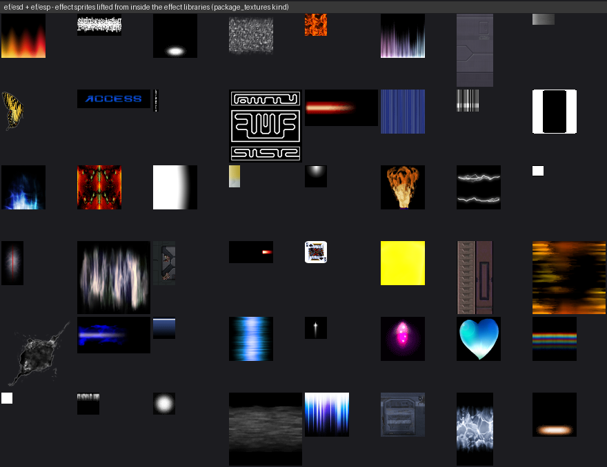
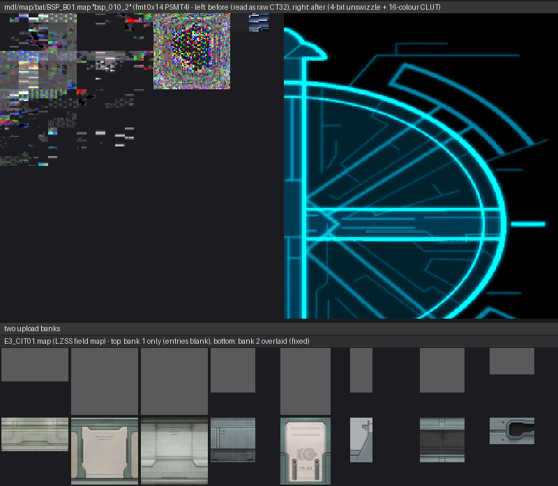

# Updates

Newest first. Each entry lists what changed, why, and what you have to do
to benefit from it. (Same convention as the Xenosaga I kit's
`docs/UPDATES.md`; this file starts with the first improvement run ported
back from that project.)

## 2026-11-20 (fourth pass) — item icons and thumbnails in one palette each, bidi = ICU, typed '$'

**itemcap / segcap: no more palette seams** (`xtx_decode.plan_palettes`).
The pictures are 125x140 (item icons) and 75x65 (location thumbnails), so
the 64-px blocks of the third pass straddled two pictures and split them
between palettes: the gold ring was gold above y = 64 and silver below, a
green bar sat under the pendant, and most thumbnails had a strip of the
neighbour's palette. The decoder now finds the picture grid from the index
map (seams where the index jump spikes; along itemcap's 2-px frames and
8-px gutters the middle seam of the run) and, when there are exactly as
many pictures as parked palettes, gives each picture a different palette by
minimum total chroma score. Both sheets have 15 pictures and 15 palettes;
the result is one palette per icon in column-major order (itemcap) and one
per thumbnail in row-major order (segcap), checked cell by cell in the
self-test and on all five discs. window0-2 and the minigame sheet do not
form such a grid and render exactly as before (byte-identical PNGs).

**Bidi now equals ICU 78 in three more corners** (`langpack.bidi_levels`):
U+2329/U+232A pair with their canonical equivalents U+3008/U+3009 and are
mirrored; a combining mark after a bracket that rule N0 resolved stays
neutral (ICU's behaviour, not the letter of UAX #9); ZWJ/ZWNJ take the next
character's level. 150,000 random strings with joiners and angle brackets
give ICU's display string (270 of 30,000 differed before). The encoder still
keeps a joiner inside the shaped run it belongs to.

**A typed `$` is warned about** (`lang encode`, `lang preview`). The game
treats every `$` as a command: its printer draws an unknown one after
logging an error, but its width function skips to the next `;`, so the
line is measured wrong. The preview used to drop the `$`; it now draws it
the way the printer does. Do not write `$5`: write the amount without the
sign (SCRIPTS.md).

**What you have to do:** re-run `browse --kinds textures_png` for the new
itemcap/segcap PNGs; re-encode translations that use angle brackets or
joiners in right-to-left text; remove any `$` typed as text.

## 2026-11-20 (third pass) — XTX pixel offset fixed, UI sheets in colour


**The XTX pixels start at 0x50, not 0x30** (`xtx_decode.py`). The header's
offset field (+0x20, always 0x30) points at a 32-byte GS upload packet: a
zero DMA tag, a VIF DIRECT code (`0x50 << 24 | W*H*4/16 + 1`) and a GIF
IMAGE tag (NLOOP `W*H*4/16`, EOP). Every one of the 1,875 XTX files on the
five discs (USA 1/2, Japan 1/2, May 2006 prototype) carries it and is exactly
`0x50 + W*H*4` bytes long. The decoder read from 0x30, so every picture was
shifted 8 words right with row wrap (16 px on the swizzled sheets, 8 px on
the `kao\` portraits) and the "32-byte trailer" was the last row's pixels.
It now validates the packet's tag words and reads after it (a file without
the packet falls back to the header offset).

**The sepia/grey limitation is mostly gone.** With the canvas aligned, the
parked palettes sit exactly on the 16-word grid, and two changes to palette
selection make use of it:

- a CLUT tile must have at least 26 fully opaque entries (raw alpha 0x80).
  Real palettes have 16-100 %, the look-alikes made of index bytes have 0 %
  (window0: 24 real tiles, 185 look-alikes dropped; itemcap: 15 and 247);
- per 64-px block, the palette with the smoothest **hue** wins. Many sheets
  park one brightness-sorted palette per picture, and all of them render any
  index map as a smooth grey-ish picture, which is why the old ranking
  always settled on a ramp. Hue separates them.

Result: the 15 item icons (itemcap, one palette each, column-major), the 15
location thumbnails (segcap), the window-sheet portraits (8 palettes, one
per 64-px block: KOS-MOS blue, Jr. red, MOMO pink, Chaos silver) and the
minigame sheet (`mg1\xx\picture`) render in their real colours.

What is still a guess: block edges do not follow picture edges, so a 64-px
block that straddles two icons can take the neighbour's palette (in itemcap
this reached inside icons: the gold ring was half silver; fixed in the fourth
pass above); the flat UI parts of window0-2 (glyphs,
gauges, frames) have no hue to rank and keep the base ramp or a guessed
palette. The HUD letter and digit cells are exact through `xtx-export --bind
statfont` (palette pointers from the executable). `titleobj` holds no
palette at all (it comes from elsewhere in VRAM) and renders as grayscale
indices. `*_index.png` is exact for every sheet.

`xtx_encode` now takes its palette plan from the decoder
(`xtx_decode.plan_palettes`), so `xtx-export`'s render equals `browse`'s
PNG. Checked on all 1,875 files: header/packet/canvas re-encode
byte-identical; the decoder's PNG (fmt 4) and `*_index.png` (fmt 8) import
back byte-identical; a one-pixel edit to the decoder's index map lands on
the same pixel after encode + decode. segcap (246-word canvas) still
decodes only.

**What you have to do:** re-run `browse --kinds textures_png`. **Index
PNGs or edits made from the old decoder's output are shifted 16 px
(swizzled) / 8 px (portraits) — re-export with `xtx-export` before
importing.** `xtx_decode` now has its own self-test (`self-test` runs 32
modules).

## 2026-11-20 (second pass) — Japanese discs, writing back, new scripts, Blender in one step

The second pass of the parity work. It adds the Japan retail pair, the whole
write side (text, fonts, pictures, any file) and the Xenosaga I translation
pipeline. **Nothing written by these commands has been booted in PCSX2.**
Every write test ran on copies of the real images (APFS clones, deleted
afterwards) and every check is a read-back from those copies, not a boot.

**Japanese discs** (`region.py`, `textcodec.py`, `sb.py`, `subtitle.py`,
`txd.py`, `njbin.py`, new `msgdat.py` and `batdat.py`):

- SLPS_256.40 / 256.41 are a verified profile, recognised by the boot
  executable's sha256. `region -v` checks 46 named executable addresses
  against the code (function signatures, data references, content hashes,
  the pair gate, the proportional-cell immediates); all 46 pass on both
  Japanese and both USA discs.
- `resolve` finds a file the way the engine does: the language folder first,
  then the folder root (Japan keeps `jpg\`, `ef\map\`, `ef\esp\` and
  `mnu\pse\` there).
- The Japanese codec (`JpCodec`) follows the executable's gate: any byte from
  0xA0 starts a pair. All 856 Japanese `.sb` files, the four `.txd`, the
  seven menu databases, `Message.Dat` and the subtitles rebuild
  byte-identically.
- `Message.Dat` and `batdat.bin` are parsed on all three builds
  (`msgdat-strings`, `batdat-strings`). The `batdat.bin` string fields are
  derived from the file's structure, not traced in game code. The meaning of
  USA `Message.Dat`'s three per-message arrays is unknown; they are kept as
  they are.
- 140 scenes exist only on the Japanese discs. They are flagged
  "JP-only, load status unknown".
- `mixed_regions` refuses USA + Japan and USA + prototype pairs.

**Writing to discs** (new `patch.py`; `disc.py`, `repack.py`, `chrtex.py`):

- `patch` writes any set of files into copies of one disc or a Disc 1 +
  Disc 2 pair. A file that fits is written in place; with `--grow` a file
  that does not is appended at the image end. A file in the shared X3.00
  index lands at the same sector on both discs, so the two discs' X3.00 stay
  identical. To do that the shorter image is padded first: USA Disc 1 grows
  from 1,915,920 to 2,205,056 sectors on its first shared grow. This is a
  safety choice; whether the engine re-reads X3.00 after a disc swap is not
  known.
- A sector budget (DVD-5 or DVD-9 by image type, `--ceiling` overrides) is
  checked before any copy is made. Every index is re-serialised and every
  patched file read back before the output is renamed into place.
- `repack-*` and `chr-iso-*` now find files through the disc's own index
  on any build; `--lba` is accepted and ignored. Bug fix: `repack-patch
  --pad` now updates the index's size field (it used to leave the old size).

**Text back in** (`textpack.py`, new `align.py`; [TRANSLATING.md](TRANSLATING.md)):

- `text-export` writes one tree for Disc 1 + Disc 2 (manifest FORMAT 2:
  build, executable hash, X3.00 hash, chain per object). Trees from the first
  pass are refused with "export again".
- `text-import` refuses anything the disc's codec cannot encode, any typed
  character the disc's own fonts have no ink for, renamed or reordered keys,
  a tree from another build, and growth without `--grow`. Nothing is written
  unless every object passes. No loader buffer size is known for any text
  object, so `--grow` is a user override, not a proof of safety.
- Unchanged trees round-trip byte-identically: 886 objects on Disc 1, 869 on
  Disc 2, 886 on the prototype, 1,025 on Japan Disc 1, 1,010 on Japan Disc 2.
- `align-export` lines up the Japanese and USA script: `.sb`, `.txd` and
  subtitles to TSV, JSON and dual-language SRT.

**New scripts** (new `langpack.py`, `glyphs.py`; `font.py`;
[SCRIPTS.md](SCRIPTS.md), [FONT.md](FONT.md)):

- `lang scan / encode / import / preview`, ported from the Xenosaga I kit:
  HarfBuzz shaping, right-to-left, pixel wrapping, `--extend` for a second
  script, multi-font packs. `--donor` brings kana and kanji from the Japanese
  font for Japanese on the USA build; `--unlock` also patches the USA
  executables to the Japanese gate. Tested with Arabic, Devanagari and
  Japanese on copies of the USA discs.
- `font.py` reads each build's rules from its executable (pair gate,
  proportional range, the A9 row). `font-jp-kana` (from the Episode II font)
  is replaced by `font-donor`, which copies cells between Episode III fonts
  and refuses unless the two fonts' kanji agree.
- `glyphs-slots / -coverage / -render / -apply / -unlock`: free cells per
  build (USA Disc 1: 123 proportional + 51 wide), TTF rendering, and the
  executable unlocks. Every Japanese character in the retail text resolves
  to an inked cell except the full-width space and 縊 (E5D0, once, in
  `bat\jp\RAV_B02.sb`), which neither Japanese font draws.

**Pictures and HUD letters** (new `xtx_encode.py`, `imagetext.py`,
`statfont.py`):

- `image-export / -import`: 1,131 localized pictures on USA Disc 1 (JPEG,
  PNG, `.xtx`, `.tm2`, effect `txy`) to PNG and back, within the file's
  sector allocation; an unchanged export imports to zero changed files.
- `xtx-export / -encode`: the UI sheets re-encode byte-identically.
- `statfont-export / -import`: the battle HUD's bitmap letters, in the window
  sheets, and their byte and width tables in the executable, on both builds.
- Found while doing this: `xtx_decode.py` reads the canvas 32 bytes early
  (the pixels start at 0x50, after a GS upload packet), so its PNGs are
  shifted right by 16 px (8-bit sheets) or 8 px (portraits). `xtx_encode`
  reads from 0x50. The decoder itself is not fixed yet, and its
  `*_index.png` files must not be fed to `xtx-encode`.

**Models** (new `blend.py`; `models_sweep.py`; [BLENDER.md](BLENDER.md)):

- `blend` writes a `.blend` with Blender in the background and checks it in a
  second run: textures packed, Material Preview, the view framed, the
  armature drawn as sticks instead of the importer's bone spheres.
- `models` reads any disc through the disc's own index, Japan included. Each
  disc: 1,609 models, 1,586 ok, 20 with an empty mesh slot, 3 `unexplained`
  maps (`E3_HAK16.map`, `E3_HAK01_EV03.map` and its standalone `.pxy`). The
  first pass counted those 3 as ok. 24 models differ between Japan and USA.

**GUI and browse:**

- The GUI is rebuilt from the command line's own parser (after the Xenosaga
  II GUI): a card per command, grouped by section, discs found by content
  (USA, Japan, prototype), 127.0.0.1 only, cross-site POSTs refused.
- `browse` follows the build of the dump it reads (`--region`, default auto:
  the boot executable in the dump, else the language folder). Japanese
  text is read with the Japanese codec; `Message.Dat`, `batdat.bin` and the
  menu databases go through their parsers instead of the ASCII sniff;
  subtitles and `.mes` files also get a UTF-8 `*.utf8.txt`; on a Japanese
  dump the JP-only scenes are listed in `text/JP-ONLY.txt`.

**Still open:**

- A PCSX2 boot of anything the kit writes: edited and grown text, new glyphs,
  right-to-left lines, the executable unlocks, the Disc 1 padding rule.
- Loader buffer sizes for text objects; the subtitle packer's size rule.
- `batdat.bin` fields from game code; USA `Message.Dat`'s per-message arrays.
- Overlay strings (an evt/ovl import as in the Xenosaga I kit) and `.xep`.
- The `xtx_decode.py` offset fix (done in the third pass, above).

**To benefit:** re-export text trees (`text-export`), since FORMAT 1 trees are
refused. Re-run `browse --kinds text` on a Japanese dump. Run `python cli.py
self-test` with `XS3_D1`, `XS3_D2`, `XS3_PROTO`, `XS3_JP1` and `XS3_JP2` set.

## 2026-11-20 — parity with the Xenosaga I/II kits: disc index, models, text, fonts

The Xenosaga II kit runs on the same engine as Episode III, so most of its
modules were brought over and checked against both US discs and the May 2006
prototype. Each copied module says at the top which kit and module it was
borrowed from and what changed. All the new commands are in `cli.py`, and
`python cli.py self-test` runs every module's self-test.

**Reading the disc directly** (no 7-Zip, no vendored `lba/` tables):

- `iso9660.py` and `toc_bin.py` read the ISO and its X3.00/X3.10/X3.20
  indexes. `chains.py` maps the containers, `disc.py` resolves in-game paths
  (with write primitives for the later repack path), and `region.py` holds the
  build profiles. `region.py` is a different module from `regions.py`, the
  LBA-to-container mapper.
- New commands:
  - `list` and `dump` (the latter writes `dump/chainN/...` plus `manifest.csv`)
  - `region`: build, executable sha256 and language folder; warns when you
    mix discs from different builds
  - `iso-ls`
  - `toc-check`
- The six index files rebuild byte for byte. On the retail discs, X3.00 matches
  `lba/Lba0.txt` line for line, and the prototype reads correctly.

**Models to glTF** (`vif.py`, `gltf.py`, `xhr.py`, `pxy.py`, `models_sweep.py`;
see [MODELS.md](MODELS.md) and [BLENDER.md](BLENDER.md)):

- `model --iso D1.iso --path 'mdl\chr\pc\C3kosmos00.chr'` converts one
  model.
- `models --iso D1.iso [--iso D2.iso] --out DIR` converts all 1,609 models on
  each disc and writes `models.csv`. `glb-info` summarises a .glb file.
- On all three discs, 1,589 models convert and pass every check. The other 20
  have an empty mesh slot. Header and decoded triangle counts agree for every
  model. Skinned meshes come out with a skeleton, and KOS-MOS's rest pose is
  exact to 5e-8.
- `browse` has a new kind, `models`, which writes `models/<path>.glb` and
  `models/models.csv`.

**Text** (`textcodec.py`, `sb.py`, `txd.py`, `njbin.py`, `subtitle.py`,
`textpack.py`):

- `text-export` writes a UTF-8 tree and a manifest covering the .sb scene
  scripts, the .txd menu tables, the nj/DBC databases, the subtitles and the
  pse files. `text-roundtrip` checks that an unchanged export rebuilds
  byte-identical.
- Every object on D1, D2 and the prototype rebuilds byte-identical.
- The USA codec follows the executable's own two-byte rule (SLUS
  `FUN_00181e48`). Bytes it cannot show become `⟦XX⟧` escapes, so every
  reading is exact.
- **`browse` text output changed.** The text files now use these codecs
  instead of the old UTF-8/EUC-JP guesses:
  - `.txd` strings and displayed `.sb` lines use the USA reading, so
    `Möbius` and `<×>` come out right.
  - The developers' notes in `.sb` files are marked `[note cp932]` or
    `[note euc_jp]`. Most of them are Shift-JIS; the old reader decoded them
    as EUC-JP.

**Fonts** (`font.py`; see [FONT.md](FONT.md)):

- New commands:
  - `font-extract`: sheet PNGs, metrics CSV, the 8x8 system font, and a code
    table
  - `font-rebuild`
  - `font-measure`: the game's own width function
  - `font-jp-kana`: restores the Japanese kana cells from the Episode II
    Japan font
- Both fonts rebuild byte-exact on all three discs.

**Requirements are now required.** numpy, Pillow, capstone, fonttools and
uharfbuzz are listed as required in `requirements.txt`:

- The launchers (`launch.command`, `launch.sh`, `launch.bat`) install them on
  first run into a private `.venv/` beside the kit, following the Xenosaga II
  launchers.
- The Windows build spec bundles them, along with every kit module.
- `disasm` no longer has its own "capstone is not installed" path.
- If a requirement is missing, the CLI refuses to run and asks you to install
  the requirements. `self-test` reports the missing one as a failure.
- No XS3 module calls fonttools or uharfbuzz yet; they are there for the
  translation work to come, as in the Xenosaga I kit.

**Still open:**

- `bat\us\batdat.bin` and `mg1\us\Message.Dat` text layouts.
- `.xap` animation.
- The text write path (budgets, font check on typed characters, writing back
  to an ISO). `disc.py` has the primitives, but growing a file past the
  bigfile extent has not been booted in PCSX2 yet.
- The Japanese profile stays unverified until a Japanese image is hashed.
- The older commands (`repack-*`, `chr-iso-*`) still use the static `lba/`
  tables.

**To benefit:** start the kit with a launcher once so it installs the
requirements, or run `python -m pip install -r requirements.txt`. Then run
`python cli.py self-test`. Set `XS3_D1`, `XS3_D2` and `XS3_PROTO` to your ISO
paths to include the disc checks.

## 2026-11-05 — Lba tables straight from the disc (`lba-from-iso`)

The kit used to depend on `lba/Lba0/1/2.txt`, which were made in 2006 by
Lybac's Windows tool *Xeno23Lbae*. Those tables only describe the US
retail discs. The game itself finds files through the three small index
files at the ISO root (`X3.00`, `X3.10`, `X3.20`). Their format was
reversed from the SLUS loader (`FUN_00187e28` lookup, `FUN_00187bd8`
directory walk, `FUN_00187b18` name decode) and is documented in
[`x3index.py`](../x3index.py).

- **New command:** `cli.py lba-from-iso --iso Disc.iso --out <work>/lba`.
  On the US discs it reproduces the vendored `Lba0.txt` (9,867 rows),
  `Lba1.txt` (3,649) and `Lba2.txt` (1,709) exactly. The only
  differences are line endings and the old tool's trailing NUL.
- **`prep` now builds the tables itself** when `<work>/lba/` is empty, so
  you no longer need to copy `lba/` first.
- **Other builds work too.** The May 22 2006 press prototype has
  different offsets (3,654 rows in Lba1, including five files that retail
  cut), so the vendored tables would extract garbage from it. The
  generated tables extract it correctly.

**To benefit:** nothing to do for the US discs. For any other build, run
`lba-from-iso` (or `prep` into a fresh work dir) instead of copying `lba/`.

## 2026-09-24 — improvement run ported from the Xenosaga I kit

Everything the XS1 extractor learned the hard way over the summer was
re-checked against the XS3 discs. Five of those lessons turned out to
apply directly; two of them overturn statements in older docs. All of it
is on the **extract/browse (viewing) side** — nothing changes what
`repack-*` / `chr-iso-*` write to an ISO.


### "No compression anywhere" was wrong: the field maps are LZSS-packed

98 of the 168 `mdl/map/*.map` packages on Disc 1 (every `E3_*` town and
dungeon) carry the version word `0x0401` instead of `0x0001`, a
decompressed size at +0x04 that is larger than the file, and a payload
that goes to noise right after the header. The XS1 lesson ("when a
coherent header runs into noise and the sizes disagree, look for
compression before inventing a format variant") led straight to the
loader in the SLUS decompile: `FUN_001b7330` switches on the version and
runs one of four LZSS decoders. All four are ported in the new
[`xcpack.py`](../xcpack.py) (spec in its docstring and in
[chr-txy-format.md](chr-txy-format.md)); every compressed map on the disc
decodes to exactly the size its header claims.

* `chrtex.py` and the browse sweep decompress transparently — `chr-decode`
  now works on any `.map`. Editing commands refuse compressed packages
  (an edited copy would not fit its disc slot without a recompressor;
  characters and weapons are stored uncompressed and edit as before).
* New CLI command `xc-unpack <package> [--out file]` prints a package's
  version / sub-resources and writes the stored (decompressed) form.

### Textures inside other files: `package_textures` browse kind

XS1 found ~3,000 textures embedded in effect libraries and scene
archives. XS3 has the same thing, in the `txy` resource the character
work already decoded:

| Carrier | What is inside |
|---------|----------------|
| `mdl/chr/*.chr`, `mdl/wpn/*.wpn` | the character / weapon atlases (previously reachable only one file at a time via `chr-decode`) |
| `mdl/map/*.map` | every field and battle backdrop texture (compressed maps included) |
| `ef/esd/**/*.esd`, `ef/esp/*.esp` | free-standing txy records: the particle / effect sprites (fire, lightning, glyphs, cards…) |
| `pac/**/*.sme` | the `esp` member repeats the effect records of the character's techs (all duplicates of `ef/`) |

`browse --kinds package_textures` decodes all of it to
`browse/textures_png/_packages/<carrier>/NN_name.png`, de-duplicates by
pixel hash, and writes `browse/package_textures.csv` (carrier, record
offset, entry name, GS format, size, sha1, written path or the duplicate
it matches, `lzss` when the carrier was decompressed). Disc 1 + the
shared X3.0x data: **~20,900 unique textures, ~18,000 duplicates**.



### PSMT4 (fmt `0x14`) textures decode



A quarter of the package entries are 4-bit (`fmt = 0x14`, the GS PSMT4
code — the entry `fmt` field is literally the GS PSM value). The old
decoder treated anything that was not `0x13` as raw CT32, so those came
out as noise. The 4-bit swizzle (block order, column word/nibble tables,
odd-column word swap) was derived against the proven 8-bit path and
verified on the battle backdrops; the 16-colour CLUT is an 8×2 CT32 tile
at the entry's `pal_x/pal_y`.

### Two more txy findings that changed decoding

* **The strip count is in the table header** (`record 0` word 5). The
  8-strip field maps have no zero terminator after strip 7 — the entry
  table follows directly — so "read strips until a zero record" swallowed
  entry 0 as a bogus 64×64 strip and stamped it over the canvas corner.
* **Field maps upload two texture banks.** A txy of version 2 points (at
  +0x14) to a second strip table that shares the entry table; the engine
  uploads bank 1 then bank 2 over it (bank 2 is narrower in its lower
  pages, so bank-1 pixels survive there). Decoding against bank 1 alone
  left a third of a town's entries fully transparent; against the overlay,
  none. Residual: a dozen entries per big map (glass-reflection sheets,
  flags) still read as noise — runtime palette state we do not have.

### Hidden text: `.txd` is menu text, `.sb` holds the field dialogue

* `.txd` was catalogued as "probably RenderWare TXD, not decoded". It is a
  **text table** (offset table + NUL-terminated strings): `menutext.txd`
  (907 strings — the whole menu UI), `synopsis.txd`, `discchg.txd`,
  `devchk.txd`. Decoded by the `text` kind as `*.txd.txt`, one
  `index<TAB>string` per line.
* `cf/us/*.sb` ("sound bank" in the old catalog) is the **scene script
  bank**: its string section is the in-map dialogue and choices ("Board
  the E.S.?", "Yes\nNo"), voice-cue ids, and the writers' EUC-JP scene
  notes ("＊BGM設定＊", stage directions) the US disc still ships. The
  XS1 kit's `.info` files were EUC-JP too — same studio habit. Decoded
  structurally as `*.sb.strings.txt`.
* `mnu/us/*.bin` databases (character / enemy / item / segment text),
  `mg1/us/Message.Dat` and friends are sniffed generically (printable
  ASCII runs) as `*.strings.txt`. `.t` scene manifests (tab-separated
  text) join the `text` kind. Disc 1: 4 `.txd` + ~730 string tables.

### Swizzled UI sheets: better, **not finished — known sepia/grey tint** (mostly fixed 2026-11-20, see the third-pass entry)


The 8 standalone `fmt = 0x08` XTX sheets (window0-2, itemcap, segcap,
ctrl, titleobj, Picture) used the *first plausible* CLUT tile, which
rendered most regions as dither noise. XS1's selector is ported: every
CLUT-looking tile is a candidate, the base palette is the one whose render
is most spatially coherent (with a transparency penalty), 64-px blocks
that still read as noise are repainted with a smoother candidate, and the
chosen tiles are blanked. Result: the *geometry* now reads — portraits are
recognisable, fonts are legible, item icons have shape — but the
**colours are still wrong**: window0 comes out sepia, itemcap's objects
grey. The ranking cannot separate a monotone ramp palette from the true
one (under a ramp every index map looks smooth), so it settles on
whichever ramp is parked in the canvas. Treat these 8 PNGs as previews;
`*_index.png` remains the ground truth. The fix is planned for a future
release and needs runtime data, not a better heuristic — see "Still
open" below.

### What the text sweep actually reads like

`cf/us/2940.sb` (a Miltia field scene), straight from `*.sb.strings.txt`:

```
[Barth]<l2>Realians of the same model as me\nare displaying strange behaviors.<w45>
[Barth]<l3>I can't exactly explain it, but they\nseem to take actions completely\nunrelated to their own will.<w45>
[Corel]<l2>And?<w15> Are you showing\nsigns of that?<w45>
[Barth]<l2>Well,<w15> I start to hear\nsomeone singing.<w45>
[Corel]<l2>Singing?<w15> That's odd.<w15>\nI wonder what the cause is.<w45>
[Owusu]<l3>There's this girl who's always\ngrowing flowers at that hospital\nup ahead!<w45>
[Emil]<l2>She's weird.<w15> She spends\nall her time at a hospital!<w45>
```

`<lN>` picks the speaker's portrait/line slot, `<wNN>` is a wait in
frames, `\n` a line break. The same bank's EUC-JP block is the writers'
scene index — `≪レンヌ・ル・シャトー、KOS-MOSと墓標≫` ("Rennes-le-Château,
KOS-MOS and the grave marker") — and `mnu/us/DBC.bin` is the in-game
encyclopedia (Ernest Luis, Aizen Magus … full entries).

### Audio, for the record

Nothing new was needed to *decode* it, but the survey confirmed what is
where: streamed BGM is `snd/adx/M*.adx` (10 tracks on Disc 1, 18 s –
132 s each, plus `E*.adx` event streams and `S*.adx`), battle callouts in
`snd/adx/bat_voice/`, movie/event voice in `snd/adx/mev/`, system
jingles in `snd/adx/sys/`; the `.dap` banks (`snd/dat/Master.dap` 55
cues, `CIT.dap` 15 …) and the per-character banks inside `pac/cf/*.sme`
hold the SE. Audio is not committed to the repository — decode your own
disc with `browse --kinds audio,soundbanks`.

### Sound banks inside `.sme`

Every combatant bundle with a `dap` sub-resource carries a complete DTPK
bank (the character's battle voice/SE cues). The `soundbanks` kind now
decodes them as `soundbanks/pac/<...>/<stem>_dap_NN.wav`.

### To pick this up

Re-run `browse` on an existing dump — no re-extract:

```
python cli.py browse --dump work/dump --stage work/browse_stage --out work/browse \
    --kinds text,textures_png,package_textures,soundbanks
```

`package_textures` is pure Python and multi-process (`--jobs`); budget a
few minutes per disc. The GUI's "Build browse" card lists the new kind.
Packaged Windows builds predate all of this until the release workflow is
re-run.

### Still open (carried into the next run)

* `.xep` event packages start with `Xc\x01\x03` but are not MR packages
  and do not decode with any of the four LZSS flavours — the event loader
  has its own scheme.
* **UI sheet colours** (2026-11-20: mostly fixed by the 0x50 pixel offset + hue ranking; see the third-pass entry). window0-2 /
  itemcap / segcap are geometrically right but sepia/grey — see above. A
  colourfulness tie-breaker tried on 2026-09-24 made things worse (wrong
  palettes pass the gate, portraits wash out) and was not shipped. A
  5-word sprite table found in SLUS at 0x2e3c54 (`w, h, u, v, id`; 139
  records) binds a *different* sheet (font glyphs). Plan: capture the
  TEX0 CBP/CSA values the menu code writes to EE RAM while a menu is open
  (the PINE rig), map them back to canvas tiles, and ship them as a
  per-sheet region→palette table.
* Which palette the engine binds to the noisy residual map entries.
* `.shp` shop tables (item-id byte lists), `.chp` character packs
  (`0x60`-word header, not Xc), `.esd`/`.esp` script bodies.
